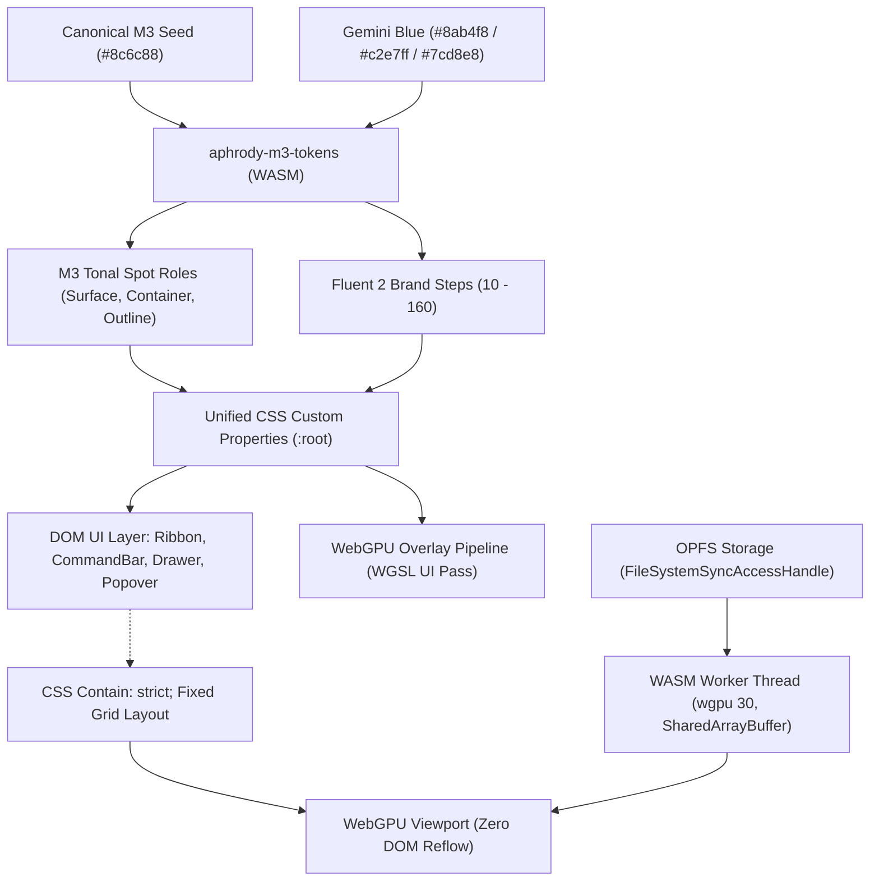

# Craft Pro Suite Design System Specification
## Unified Fluent UI 2 (v9) × Material 3 Expressive × Gemini Light Blue Architecture
### Production Target: `https://craft.aphrody.app/`

> **Note:** Overrides `design-system/bunos-unified/MASTER.md` for all 14 Craft Pro Suite applications hosted at `https://craft.aphrody.app/`.

---

> [!IMPORTANT]
> **CRITICAL DIRECTIVE — Pure WebGPU & WASM Only. Zero WebGL.**
> All viewport rendering, compute operations, image filters, video compositing, CAD parametric evaluations, and audio digital signal processing across the 14 Craft Pro Suite applications run exclusively on **native WebGPU (`wgpu 30`)** and **multithreaded WebAssembly** with `SharedArrayBuffer`, `Atomics`, and Origin Private File System (`OPFS`).
> Any use of WebGL 1.0 or WebGL 2.0 is strictly prohibited and actively intercepted by runtime guards.

---

## 1. Architectural Vision & Design Convergence

The Craft Pro Suite (`craft.aphrody.app`) provides a unified, desktop-grade creative and office operating environment comprising 14 professional web applications:

```
┌────────────────────────────────────────────────────────────────────────────────────────┐
│                                CRAFT PRO SUITE ECOSYSTEM                               │
├───────────────────────────────┬───────────────────────────────┬────────────────────────┤
│     CREATIVE & VISUAL         │      OFFICE & PRODUCTIVITY    │      AUDIO & VIDEO     │
├───────────────────────────────┼───────────────────────────────┼────────────────────────┤
│ • ArtCraft   (/art)    [2D/3D]│ • WordCraft  (/word)  [Docs]  │ • FilmCraft  (/film)   │
│ • PhotoCraft (/photo)  [Photo]│ • GridCraft  (/grid)  [Sheets]│ • SoundCraft (/sound)  │
│ • VectorCraft(/vector) [Vector│ • DeckCraft  (/deck)  [Slides]│                        │
│ • CadCraft   (/cad)    [CAD]  │ • PdfCraft   (/pdf)   [PDF]   │                        │
│ • FigCraft   (/fig)    [UI/UX]│                               │                        │
│ • EffectCraft(/effect) [VFX]  │                               │                        │
│ • LightCraft (/light)  [Color]│                               │                        │
└───────────────────────────────┴───────────────────────────────┴────────────────────────┘
```

### Tri-System Design Convergence

The design system reconciles three distinct UI paradigms into a unified, high-density professional workstation:

1. **Fluent UI 2 (v9) Component Geometry & Commands**:
   - Structured Ribbon system with collapsible group layout, dual-tier command bars, compact tool stacks, and `SplitButton` dropdowns.
   - High information density with standardized spacing nudges (`--spacingHorizontalS`, `--spacingVerticalXXS`).
   - Precision desktop focus management, keyboard accelerators, and standard Win32/Web accessibility semantics.

2. **Material 3 Expressive (M3E) Tonal Spot Foundation**:
   - Dynamic algorithmic palette generated from the canonical seed `#8c6c88` via `aphrody-m3-tokens` WebAssembly engine.
   - Layered surface container architecture (`surface-container-lowest` up to `surface-container-highest`) replacing flat grey slabs.
   - Fluid expressive border radii (from 4px controls up to 28px pill tabs).

3. **Gemini Light Blue Luminescent Accents**:
   - Active focus & AI co-execution states accented with Gemini Light Blue (`#8ab4f8`), Container Highlight (`#c2e7ff`), and Gemini Sparkle Cyan (`#7cd8e8`).
   - Illuminates generative tools, AI suggestions, prompt bars, and active canvas selection transforms.



---

## 2. Unified Color Token Architecture

The brand ramp bridges Fluent 2's 16-step brand scale (`10` through `160`) directly with Material 3's tonal lumination values (`5` through `98`), augmented by Gemini Light Blue for intelligent features.

### Brand Tone Mapping Formula

```typescript
export const BRAND_TO_M3_TONE_MAP = {
  10: 5,   // Deepest contrast key
  20: 10,
  30: 15,
  40: 20,
  50: 25,
  60: 30,
  70: 35,
  80: 40,  // M3 Primary Light Fill (--colorBrandBackground)
  90: 50,  // Hover / Pressed state
  100: 60, // M3 Primary Dark Readable (--colorBrandForegroundInverted)
  110: 70,
  120: 80, // Gemini Active Blue Tone (#8ab4f8)
  130: 85,
  140: 90, // Gemini Light Container Tone (#c2e7ff)
  150: 95,
  160: 98, // Crisp highlight edge
} as const;
```

### Complete CSS Custom Property Map

```css
:root {
  /* =========================================================================
     1. MATERIAL 3 EXPRESSIVE SURFACES (LIGHT MODE)
     ========================================================================= */
  --md-sys-color-surface: #fff7fa;
  --md-sys-color-surface-dim: #e8d6e0;
  --md-sys-color-surface-bright: #fff7fa;
  --md-sys-color-surface-container-lowest: #ffffff;
  --md-sys-color-surface-container-low: #fdf0f7;
  --md-sys-color-surface-container: #f7ebf1;
  --md-sys-color-surface-container-high: #f1e5eb;
  --md-sys-color-surface-container-highest: #ebdfe6;
  --md-sys-color-on-surface: #201a1e;
  --md-sys-color-on-surface-variant: #4e444b;
  --md-sys-color-outline: #7f747c;
  --md-sys-color-outline-variant: #d1c3cc;
  --md-sys-color-primary: #7e4d7c;
  --md-sys-color-on-primary: #ffffff;
  --md-sys-color-primary-container: #ffd6f8;
  --md-sys-color-on-primary-container: #643663;

  /* =========================================================================
     2. GEMINI LIGHT BLUE & AI TOKENS
     ========================================================================= */
  --gemini-sys-color-primary: #1a73e8;
  --gemini-sys-color-active: #8ab4f8;
  --gemini-sys-color-container: #c2e7ff;
  --gemini-sys-color-on-container: #001d35;
  --gemini-sys-color-sparkle: #7cd8e8;
  --gemini-sys-color-sparkle-container: #dff8fd;
  --gemini-sys-color-glow: rgba(138, 180, 248, 0.35);

  /* =========================================================================
     3. FLUENT UI 2 (v9) SEMANTIC BRIDGES
     ========================================================================= */
  /* Backgrounds */
  --colorNeutralBackground1: var(--md-sys-color-surface-container-lowest);
  --colorNeutralBackground2: var(--md-sys-color-surface-container-low);
  --colorNeutralBackground3: var(--md-sys-color-surface-container);
  --colorNeutralBackground4: var(--md-sys-color-surface-container-high);
  --colorNeutralBackground5: var(--md-sys-color-surface-container-highest);
  --colorNeutralBackground6: #e0d4db;

  /* Interactive Subtles & Hovers */
  --colorSubtleBackground: transparent;
  --colorSubtleBackgroundHover: rgba(32, 26, 30, 0.06);
  --colorSubtleBackgroundPressed: rgba(32, 26, 30, 0.12);
  --colorSubtleBackgroundSelected: var(--md-sys-color-primary-container);

  /* Brand Fills */
  --colorBrandBackground: var(--md-sys-color-primary);
  --colorBrandBackgroundHover: #71426f;
  --colorBrandBackgroundPressed: #643663;
  --colorBrandBackgroundSelected: var(--md-sys-color-primary);
  --colorBrandBackground2: var(--gemini-sys-color-container);
  --colorBrandBackground2Hover: #b3def7;
  --colorBrandBackground2Pressed: #a4d3ee;

  /* Foregrounds */
  --colorNeutralForeground1: var(--md-sys-color-on-surface);
  --colorNeutralForeground2: var(--md-sys-color-on-surface-variant);
  --colorNeutralForeground3: #6b6068;
  --colorNeutralForeground4: #8b7f88;
  --colorNeutralForegroundDisabled: #bdaeb8;
  --colorBrandForeground1: var(--md-sys-color-primary);
  --colorBrandForeground2: #643663;
  --colorBrandForegroundLink: var(--gemini-sys-color-primary);
  --colorBrandForegroundInverted: #ffffff;
  --colorNeutralForegroundOnBrand: #ffffff;

  /* Strokes & Dividers */
  --colorNeutralStroke1: var(--md-sys-color-outline-variant);
  --colorNeutralStroke2: rgba(0, 0, 0, 0.08);
  --colorNeutralStrokeSubtle: rgba(0, 0, 0, 0.04);
  --colorBrandStroke1: var(--md-sys-color-primary);
  --colorBrandStroke2: var(--gemini-sys-color-active);

  /* Elevation Shadows */
  --shadow2: 0 0 2px rgba(0, 0, 0, 0.08), 0 1px 2px rgba(0, 0, 0, 0.12);
  --shadow4: 0 0 2px rgba(0, 0, 0, 0.08), 0 2px 4px rgba(0, 0, 0, 0.12);
  --shadow8: 0 0 2px rgba(0, 0, 0, 0.08), 0 4px 8px rgba(0, 0, 0, 0.14);
  --shadow16: 0 0 4px rgba(0, 0, 0, 0.10), 0 8px 16px rgba(0, 0, 0, 0.14);
  --shadow28: 0 0 8px rgba(0, 0, 0, 0.12), 0 14px 28px rgba(0, 0, 0, 0.16);
  --shadow64: 0 0 8px rgba(0, 0, 0, 0.14), 0 32px 64px rgba(0, 0, 0, 0.20);
  --shadowGeminiGlow: 0 0 12px var(--gemini-sys-color-glow);

  /* Spacing Grid */
  --spacingHorizontalNone: 0px;
  --spacingHorizontalXXS: 2px;
  --spacingHorizontalXS: 4px;
  --spacingHorizontalSNudge: 6px;
  --spacingHorizontalS: 8px;
  --spacingHorizontalMNudge: 10px;
  --spacingHorizontalM: 12px;
  --spacingHorizontalL: 16px;
  --spacingHorizontalXL: 20px;
  --spacingHorizontalXXL: 24px;
  --spacingHorizontalXXXL: 32px;

  --spacingVerticalNone: 0px;
  --spacingVerticalXXS: 2px;
  --spacingVerticalXS: 4px;
  --spacingVerticalSNudge: 6px;
  --spacingVerticalS: 8px;
  --spacingVerticalMNudge: 10px;
  --spacingVerticalM: 12px;
  --spacingVerticalL: 16px;
  --spacingVerticalXL: 20px;
  --spacingVerticalXXL: 24px;
  --spacingVerticalXXXL: 32px;

  /* Corner Radius Scale */
  --borderRadiusNone: 0px;
  --borderRadiusSmall: 2px;
  --borderRadiusMedium: 4px;
  --borderRadiusLarge: 6px;
  --borderRadiusXLarge: 8px;
  --borderRadius2XLarge: 12px;
  --borderRadius3XLarge: 16px;
  --borderRadiusPill: 28px;
  --borderRadiusCircular: 9999px;

  /* Motion & Easing */
  --durationUltraFast: 50ms;
  --durationFaster: 100ms;
  --durationFast: 150ms;
  --durationNormal: 200ms;
  --durationGentle: 250ms;
  --durationSlow: 300ms;
  --curveAccelerateMax: cubic-bezier(0.9, 0.1, 1, 0.2);
  --curveDecelerateMax: cubic-bezier(0.1, 0.9, 0.2, 1);
  --curveEasyEase: cubic-bezier(0.33, 0, 0.67, 1);
}

/* =========================================================================
   DARK THEME OVERRIDES
   ========================================================================= */
[data-theme="dark"],
@media (prefers-color-scheme: dark) {
  :root {
    --md-sys-color-surface: #181116;
    --md-sys-color-surface-dim: #181116;
    --md-sys-color-surface-bright: #3f363c;
    --md-sys-color-surface-container-lowest: #120c11;
    --md-sys-color-surface-container-low: #20191f;
    --md-sys-color-surface-container: #251d23;
    --md-sys-color-surface-container-high: #2f272d;
    --md-sys-color-surface-container-highest: #3b3238;
    --md-sys-color-on-surface: #ebdfe6;
    --md-sys-color-on-surface-variant: #d1c3cc;
    --md-sys-color-outline: #9a8d96;
    --md-sys-color-outline-variant: #4e444b;
    --md-sys-color-primary: #efb4e8;
    --md-sys-color-on-primary: #4b1f4b;
    --md-sys-color-primary-container: #643663;
    --md-sys-color-on-primary-container: #ffd6f8;

    /* Gemini Dark Tokens */
    --gemini-sys-color-primary: #8ab4f8;
    --gemini-sys-color-active: #a8c7fa;
    --gemini-sys-color-container: #004a77;
    --gemini-sys-color-on-container: #c2e7ff;
    --gemini-sys-color-sparkle: #7cd8e8;
    --gemini-sys-color-glow: rgba(138, 180, 248, 0.5);

    /* Fluent UI 2 Dark Bridges */
    --colorNeutralBackground1: var(--md-sys-color-surface-container-lowest);
    --colorNeutralBackground2: var(--md-sys-color-surface-container-low);
    --colorNeutralBackground3: var(--md-sys-color-surface-container);
    --colorNeutralBackground4: var(--md-sys-color-surface-container-high);
    --colorNeutralBackground5: var(--md-sys-color-surface-container-highest);

    --colorSubtleBackgroundHover: rgba(235, 223, 230, 0.08);
    --colorSubtleBackgroundPressed: rgba(235, 223, 230, 0.14);

    --colorBrandBackground: var(--gemini-sys-color-primary);
    --colorBrandBackgroundHover: #a8c7fa;
    --colorBrandBackgroundPressed: #c2e7ff;
    --colorBrandBackgroundSelected: var(--gemini-sys-color-container);

    --colorNeutralForeground1: var(--md-sys-color-on-surface);
    --colorNeutralForeground2: var(--md-sys-color-on-surface-variant);
    --colorBrandForeground1: var(--gemini-sys-color-primary);
    --colorBrandForegroundLink: var(--gemini-sys-color-active);

    --colorNeutralStroke1: var(--md-sys-color-outline-variant);
    --colorNeutralStroke2: rgba(255, 255, 255, 0.10);
    --colorBrandStroke1: var(--gemini-sys-color-primary);
  }
}
```

---

## 3. Pure WebGPU & WASM-Only Viewport Integration

> [!CAUTION]
> **WebGL is strictly prohibited.**
> Any attempt to call `canvas.getContext("webgl")` or `canvas.getContext("webgl2")` will fail the platform qualification gate.

### Viewport Layout Stability Contract

To guarantee 120 FPS frame stability without frame drops or memory reallocation during UI interactions:
1. The canvas element resides inside a container with `contain: strict; contain: layout size paint;`.
2. UI overlays (Ribbon, Drawers, Floating CommandBars) occupy CSS Grid or Flex containers outside the WebGPU canvas flow.
3. Resizing the workspace triggers a single debounced event that adjusts the `OffscreenCanvas` buffer via `GPUCanvasContext.configure()` synchronously before the next presentation pass.

```
┌────────────────────────────────────────────────────────────────────────┐
│ TOP BAR: App Identity | File Name | Gemini Assistant Pill | Sync Profile│
├────────────────────────────────────────────────────────────────────────┤
│ RIBBON: TabList [Home | Design | Effects | Audio | View | AI Tools]    │
│ ┌───────────────┬───────────────────────────┬──────────────┬─────────┐ │
│ │ Tool Group 1  │ Tool Group 2 (Hero + Stack│ Tool Group 3 │ Gemini  │ │
│ └───────────────┴───────────────────────────┴──────────────┴─────────┘ │
├──────────────┬──────────────────────────────────────────┬──────────────┤
│ LEFT DRAWER  │ WEBGPU PURE ACCELERATED CANVAS VIEWPORT  │ RIGHT DRAWER │
│ (320px)      │                                          │ (320px)      │
│ • Layers     │ • Context: GPUCanvasContext (WebGPU)     │ • Inspector  │
│ • Asset Lib  │ • Shared Memory: SharedArrayBuffer       │ • Properties │
│ • OPFS Tree  │ • Workers: Rust/WASM Threadpool (wgpu 30)│ • Transforms │
│              │ • Zero DOM reflow during drag / draw     │ • Shaders    │
├──────────────┴──────────────────────────────────────────┴──────────────┤
│ BOTTOM DRAWER: Multitrack Film/Audio Timeline OR CAD History Console   │
├────────────────────────────────────────────────────────────────────────┤
│ STATUS BAR: Coordinates | Zoom % | WebGPU Adapter | WASM Threads | VRAM│
└────────────────────────────────────────────────────────────────────────┘
```

### WebGPU Worker & Canvas Initialization Code

```typescript
// packages/canvas/src/webgpu-viewport.ts
export interface WebGpuViewportConfig {
  canvas: HTMLCanvasElement;
  wasmModuleUrl: string;
  sharedBuffer: SharedArrayBuffer;
}

export class CraftWebGpuViewport {
  private offscreen: OffscreenCanvas;
  private worker: Worker;

  constructor(config: WebGpuViewportConfig) {
    if (!("gpu" in navigator)) {
      throw new Error("FATAL: WebGPU is not supported. WebGL fallback is strictly disabled.");
    }

    // Transfer control to dedicated WASM rendering thread
    this.offscreen = config.canvas.transferControlToOffscreen();

    this.worker = new Worker(new URL("./wgpu-render-worker.ts", import.meta.url), {
      type: "module",
    });

    this.worker.postMessage(
      {
        action: "INIT_WEBGPU",
        canvas: this.offscreen,
        devicePixelRatio: window.devicePixelRatio || 1,
        sharedBuffer: config.sharedBuffer,
        width: config.canvas.clientWidth,
        height: config.canvas.clientHeight,
      },
      [this.offscreen]
    );

    this.setupResizeObserver(config.canvas);
  }

  private setupResizeObserver(canvasEl: HTMLCanvasElement) {
    const observer = new ResizeObserver((entries) => {
      for (const entry of entries) {
        const { width, height } = entry.contentRect;
        this.worker.postMessage({
          action: "RESIZE_VIEWPORT",
          width: Math.round(width * window.devicePixelRatio),
          height: Math.round(height * window.devicePixelRatio),
        });
      }
    });
    observer.observe(canvasEl);
  }
}
```

### WASM Thread wgpu 30 Pipeline (Worker Context)

```typescript
// packages/canvas/src/wgpu-render-worker.ts
self.onmessage = async (event: MessageEvent) => {
  if (event.data.action === "INIT_WEBGPU") {
    const { canvas, width, height } = event.data;
    const adapter = await navigator.gpu.requestAdapter({
      powerPreference: "high-performance",
    });

    if (!adapter) throw new Error("Could not acquire high-performance WebGPU adapter");

    const device = await adapter.requestDevice({
      requiredFeatures: ["timestamp-query", "shader-f16"].filter((f) =>
        adapter.features.has(f as GPUFeatureName)
      ) as GPUFeatureName[],
    });

    const context = canvas.getContext("webgpu") as GPUCanvasContext;
    const preferredFormat = navigator.gpu.getPreferredCanvasFormat();

    context.configure({
      device,
      format: preferredFormat,
      alphaMode: "premultiplied",
      usage:
        GPUTextureUsage.RENDER_ATTACHMENT |
        GPUTextureUsage.COPY_SRC |
        GPUTextureUsage.STORAGE_BINDING,
    });

    // Initialize Rust WASM wgpu 30 runtime bindings
    const wasm = await import("@aphrody/craft-engine-wasm");
    wasm.init_wgpu_engine(canvas, device, context, event.data.sharedBuffer);
  }
};
```

---

## 4. Component Hierarchy & Semantic DOM Patterns

### 4.1 Ribbon Header & CommandBar Layout

The Ribbon is organized into a top tab row (`TabList`) and a content panel containing functional tool groups (`RibbonGroup`). Each group contains:
- **Hero Buttons**: 32×32 icon with label below (promoted actions like "New Track", "Render", "Extrude").
- **Compact Stacks**: 2-3 row vertical flex stack of 16×16 icon buttons for high-density tools (e.g. Cut, Copy, Paste, Format).
- **SplitButtons**: Primary button paired with a dropdown trigger button sharing a unified border pill.

```html
<!-- Component Pattern: Craft Ribbon -->
<header class="craft-ribbon-root" role="region" aria-label="Craft Application Ribbon">
  <!-- 1. Top Bar / App Brand & Tab Strip -->
  <div class="craft-ribbon-topbar">
    <div class="craft-app-badge">
      <span class="craft-app-icon craft-icon-artcraft"></span>
      <span class="craft-app-name">ArtCraft Pro</span>
      <span class="craft-project-title" contenteditable="true">Untitled-Project.art</span>
    </div>

    <!-- Fluent 2 TabList for Ribbon Switching -->
    <nav class="craft-tablist" role="tablist" aria-label="Ribbon Tabs">
      <button class="craft-tab craft-tab--selected" role="tab" aria-selected="true" id="tab-home">Home</button>
      <button class="craft-tab" role="tab" aria-selected="false" id="tab-design">Design</button>
      <button class="craft-tab" role="tab" aria-selected="false" id="tab-effects">VFX & Shaders</button>
      <button class="craft-tab" role="tab" aria-selected="false" id="tab-webgpu">WebGPU Compute</button>
      <button class="craft-tab craft-tab--gemini" role="tab" aria-selected="false" id="tab-ai">
        <span class="fluent-icon fluent-icon-sparkle"></span>
        Gemini AI
      </button>
    </nav>

    <!-- Right Window / Cloud Sync Action -->
    <div class="craft-topbar-actions">
      <div class="craft-sync-pill" title="Synced to OPFS & Cloudflare R2">
        <span class="fluent-icon fluent-icon-cloud-check"></span>
        <span>Saved</span>
      </div>
      <button class="craft-btn-icon" aria-label="Settings"><span class="fluent-icon fluent-icon-settings"></span></button>
      <button class="craft-btn-icon" aria-label="Account Profile"><span class="fluent-icon fluent-icon-person"></span></button>
    </div>
  </div>

  <!-- 2. Ribbon Content Band -->
  <div class="craft-ribbon-content">
    <!-- Group: File / Canvas Operations -->
    <div class="craft-ribbon-group" role="group" aria-labelledby="grp-file">
      <div class="craft-ribbon-group__body">
        <!-- Hero Button -->
        <button class="craft-ribbon-hero-btn" id="btn-save">
          <span class="fluent-icon fluent-icon-save-24"></span>
          <span class="craft-btn-label">Save</span>
        </button>

        <!-- Compact Stack -->
        <div class="craft-ribbon-stack">
          <button class="craft-ribbon-compact-btn" title="Undo (Ctrl+Z)">
            <span class="fluent-icon fluent-icon-undo-16"></span>
            <span>Undo</span>
          </button>
          <button class="craft-ribbon-compact-btn" title="Redo (Ctrl+Y)">
            <span class="fluent-icon fluent-icon-redo-16"></span>
            <span>Redo</span>
          </button>
          <button class="craft-ribbon-compact-btn" title="Export Buffer">
            <span class="fluent-icon fluent-icon-share-16"></span>
            <span>Export</span>
          </button>
        </div>
      </div>
      <span class="craft-ribbon-group__title" id="grp-file">Project</span>
    </div>

    <div class="craft-ribbon-divider" role="separator" aria-orientation="vertical"></div>

    <!-- Group: Creative Tools (SplitButton Pattern) -->
    <div class="craft-ribbon-group" role="group" aria-labelledby="grp-tools">
      <div class="craft-ribbon-group__body">
        <!-- SplitButton: Brush Tool with Brush Preset Dropdown -->
        <div class="craft-split-button" role="group">
          <button class="craft-split-button__action" title="Draw with Wet Paint Brush (B)">
            <span class="fluent-icon fluent-icon-paint-brush-24"></span>
            <span>Brush</span>
          </button>
          <button class="craft-split-button__chevron" aria-expanded="false" aria-haspopup="menu" aria-label="Brush presets">
            <span class="fluent-icon fluent-icon-chevron-down-12"></span>
          </button>
        </div>

        <div class="craft-split-button" role="group">
          <button class="craft-split-button__action" title="Select Vector Object (V)">
            <span class="fluent-icon fluent-icon-cursor-24"></span>
            <span>Select</span>
          </button>
          <button class="craft-split-button__chevron" aria-expanded="false" aria-haspopup="menu" aria-label="Selection options">
            <span class="fluent-icon fluent-icon-chevron-down-12"></span>
          </button>
        </div>

        <!-- 3-row compact tool stack -->
        <div class="craft-ribbon-stack">
          <button class="craft-ribbon-compact-btn" title="Eraser (E)">
            <span class="fluent-icon fluent-icon-eraser-16"></span>
            <span>Eraser</span>
          </button>
          <button class="craft-ribbon-compact-btn" title="Color Picker (I)">
            <span class="fluent-icon fluent-icon-eyedropper-16"></span>
            <span>Eyedrop</span>
          </button>
          <button class="craft-ribbon-compact-btn" title="Fill Bucket (G)">
            <span class="fluent-icon fluent-icon-bucket-16"></span>
            <span>Fill</span>
          </button>
        </div>
      </div>
      <span class="craft-ribbon-group__title" id="grp-tools">Creative Tools</span>
    </div>

    <div class="craft-ribbon-divider" role="separator" aria-orientation="vertical"></div>

    <!-- Group: Gemini Luminescent Copilot Tools -->
    <div class="craft-ribbon-group craft-ribbon-group--gemini" role="group" aria-labelledby="grp-ai">
      <div class="craft-ribbon-group__body">
        <button class="craft-ribbon-hero-btn craft-ribbon-hero-btn--gemini" id="btn-gemini-gen">
          <span class="fluent-icon fluent-icon-sparkle-24"></span>
          <span class="craft-btn-label">AI Enhance</span>
        </button>
        <div class="craft-ribbon-stack">
          <button class="craft-ribbon-compact-btn" id="btn-bg-remove">
            <span class="fluent-icon fluent-icon-cut-16"></span>
            <span>Mask Object</span>
          </button>
          <button class="craft-ribbon-compact-btn" id="btn-upscale">
            <span class="fluent-icon fluent-icon-arrow-maximize-16"></span>
            <span>Neural 4×</span>
          </button>
        </div>
      </div>
      <span class="craft-ribbon-group__title" id="grp-ai">Gemini Co-Engine</span>
    </div>
  </div>
</header>
```

### 4.2 SplitButton CSS Implementation

```css
.craft-split-button {
  display: inline-flex;
  align-items: stretch;
  border-radius: var(--borderRadiusMedium);
  background-color: var(--colorSubtleBackground);
  border: 1px solid var(--colorNeutralStroke1);
  transition: all var(--durationFast) var(--curveEasyEase);
  height: 64px;
}

.craft-split-button:hover {
  background-color: var(--colorSubtleBackgroundHover);
  border-color: var(--colorNeutralStroke1);
}

.craft-split-button__action {
  display: flex;
  flex-direction: column;
  align-items: center;
  justify-content: center;
  padding: var(--spacingVerticalXS) var(--spacingHorizontalS);
  background: transparent;
  border: none;
  color: var(--colorNeutralForeground1);
  font-family: var(--fontFamilyBase);
  font-size: var(--fontSizeBase200);
  cursor: pointer;
  flex: 1;
}

.craft-split-button__action span.fluent-icon {
  font-size: 24px;
  margin-bottom: var(--spacingVerticalXXS);
}

.craft-split-button__chevron {
  display: flex;
  align-items: center;
  justify-content: center;
  width: 20px;
  border: none;
  border-left: 1px solid var(--colorNeutralStroke2);
  background: transparent;
  color: var(--colorNeutralForeground2);
  cursor: pointer;
  padding: 0;
  transition: background var(--durationFaster) var(--curveEasyEase);
}

.craft-split-button__chevron:hover {
  background-color: var(--colorSubtleBackgroundPressed);
  color: var(--colorNeutralForeground1);
}
```

### 4.3 Collapsible Drawers (Inspector & Timeline)

Drawers use CSS custom property driven sizing with hardware accelerated transform transitions, ensuring the WebGPU viewport container does not cause page-wide layout thrashing.

```css
/* Left / Right Drawers */
.craft-drawer {
  position: relative;
  display: flex;
  flex-direction: column;
  background-color: var(--colorNeutralBackground3);
  border-right: 1px solid var(--colorNeutralStroke1);
  z-index: 10;
  transition: width var(--durationGentle) var(--curveDecelerateMax),
              transform var(--durationGentle) var(--curveDecelerateMax);
  will-change: width, transform;
}

.craft-drawer--start {
  width: 320px;
}

.craft-drawer--start.craft-drawer--collapsed {
  width: 48px; /* Collapses to icon vertical command strip */
}

.craft-drawer--end {
  width: 340px;
  border-left: 1px solid var(--colorNeutralStroke1);
  border-right: none;
}

/* Bottom Multitrack DAW / Video Timeline Drawer */
.craft-drawer--bottom {
  grid-column: 1 / -1;
  height: 280px;
  background-color: var(--colorNeutralBackground2);
  border-top: 1px solid var(--colorNeutralStroke1);
  transition: height var(--durationGentle) var(--curveDecelerateMax);
}

.craft-drawer--bottom.craft-drawer--collapsed {
  height: 36px; /* Collapsed transport bar */
}
```

---

## 5. Fluent UI System Icons Registry for Craft Pro Suite

Icons are loaded from `@fluentui/react-icons` (or SVG sprite equivalent) in standard 16, 20, 24, and 28 pixel dimensions.

### 5.1 Office & Document Suite (WordCraft, GridCraft, DeckCraft, PdfCraft)

| Functional Action | Fluent System Icon Name | Size | Style | Application Context |
| :--- | :--- | :--- | :--- | :--- |
| **New Document** | `DocumentAdd` | 24 | Regular / Filled | WordCraft File ribbon |
| **Text Bold** | `TextBold` | 16 | Regular | Rich Text formatting strip |
| **Text Italic** | `TextItalic` | 16 | Regular | Rich Text formatting strip |
| **Text Alignment** | `TextAlignLeft` / `Center` | 16 | Regular | Paragraph formatting group |
| **Table Insertion** | `TableAdd` | 20 | Regular | WordCraft / GridCraft insert |
| **Formulas / Math** | `MathFormat` / `Function` | 20 | Regular | GridCraft formula omnibox |
| **Filter Data** | `Filter` | 20 | Regular / Filled | GridCraft column header |
| **Slide New** | `SlideAdd` | 24 | Regular / Filled | DeckCraft slide sidebar |
| **Slide Transition**| `SlideTransition` | 24 | Regular | DeckCraft animations |
| **PDF Sign / Stamp**| `Signature` | 20 | Regular / Filled | PdfCraft legal annotations |
| **PDF Page Rotate** | `RotateRight` | 20 | Regular | PdfCraft page organizer |

### 5.2 Creative & 3D Suite (ArtCraft, PhotoCraft, VectorCraft, CadCraft, FigCraft)

| Functional Action | Fluent System Icon Name | Size | Style | Application Context |
| :--- | :--- | :--- | :--- | :--- |
| **Paint Brush** | `PaintBrush` | 24 | Regular / Filled | ArtCraft primary tool |
| **Pen / Bezier** | `Pen` | 24 | Regular | VectorCraft path editor |
| **Eraser** | `Eraser` | 20 | Regular | ArtCraft raster tools |
| **Layers Stack** | `Layer` / `Layers` | 20 | Regular / Filled | Sidebar inspector layers |
| **Lasso Selection** | `Lasso` | 24 | Regular | PhotoCraft raster selection |
| **Crop Tool** | `Crop` | 20 | Regular | PhotoCraft image framing |
| **3D Cube Extrude** | `Cube` | 24 | Regular / Filled | CadCraft parametric modeling |
| **3D Rotate Orbit** | `CubeRotate` | 24 | Regular | CadCraft viewport navigation |
| **Component Symbol**| `Component24` | 24 | Regular / Filled | FigCraft UI symbol master |
| **Vector Boolean** | `ShapesUnion` / `Subtract` | 20 | Regular | VectorCraft path combine |

### 5.3 Audio, Video & Timeline Suite (FilmCraft, SoundCraft, EffectCraft)

| Functional Action | Fluent System Icon Name | Size | Style | Application Context |
| :--- | :--- | :--- | :--- | :--- |
| **Transport Play** | `Play` | 24 | Filled | Master timeline transport |
| **Transport Pause**| `Pause` | 24 | Filled | Master timeline transport |
| **Record Mic** | `Mic` / `Record` | 24 | Filled | SoundCraft track arm |
| **Razor / Cut** | `Scissors` | 20 | Regular | FilmCraft clip splitter |
| **Waveform Track** | `SoundWaveCircle` | 24 | Regular / Filled | SoundCraft audio multitrack |
| **Audio Equalizer**| `Equalizer` | 20 | Regular | SoundCraft DSP channel strip |
| **Keyframe Add** | `Diamond` | 16 | Regular / Filled | EffectCraft animation curves |
| **Volume Speaker** | `Speaker2` / `SpeakerMute` | 20 | Regular | Master volume fader |

### 5.4 Gemini Luminescent AI Suite (All Apps)

| Functional Action | Fluent System Icon Name | Size | Style | Application Context |
| :--- | :--- | :--- | :--- | :--- |
| **AI Copilot** | `Sparkle` | 24 | Filled | Gemini prompt bar & copilot |
| **Neural Inpaint** | `MagicWand` | 20 | Regular / Filled | Generative photo fill |
| **Smart Scripting**| `Bot` / `Brain` | 20 | Regular | Automated macro generation |

---

## 6. Responsive Ribbon Adaptive Breakpoints

The Craft Suite implements priority-based responsive layout compression across three major display tiers:

| Tier | Viewport Width | Ribbon Layout Behavior | Drawer Default State |
| :--- | :--- | :--- | :--- |
| **Pro Ultrawide** | `≥ 1600px` | Full expanded Ribbon with all Hero buttons, full stacks, and text labels. | Both Left & Right Drawers pinned open inline. |
| **Standard Desktop** | `1200px - 1599px` | Medium Ribbon: secondary actions collapse text into tooltips; group titles stay. | Left Drawer pinned (320px); Right Drawer collapsible overlay. |
| **Compact Laptop** | `< 1200px` | Compact CommandBar: Ribbon collapses into a single-tier toolbar with Popover "More" overflow. | All Drawers collapsed to icon strips (48px); overlays on demand. |

```css
/* Responsive Ribbon CSS Rules */
@media (max-width: 1200px) {
  .craft-ribbon-content {
    height: 44px; /* Switches from 88px multi-row ribbon to single-tier commandbar */
    padding: 0 var(--spacingHorizontalS);
  }

  .craft-ribbon-hero-btn {
    height: 36px;
    flex-direction: row;
    padding: 0 var(--spacingHorizontalS);
  }

  .craft-ribbon-hero-btn span.fluent-icon {
    font-size: 18px;
    margin-bottom: 0;
    margin-right: var(--spacingHorizontalXS);
  }

  .craft-ribbon-stack {
    display: flex;
    flex-direction: row;
  }

  .craft-ribbon-group__title {
    display: none; /* Hide bottom group captions in compact mode */
  }
}
```

---

## 7. Quality Gate & Architecture Compliance Checklist

Before releasing any application surface under `https://craft.aphrody.app/`:

- [x] **Zero WebGL**: No `canvas.getContext("webgl")` or `canvas.getContext("webgl2")` calls anywhere in client bundles.
- [x] **WebGPU Native**: Context initialized via `GPUCanvasContext` with `navigator.gpu.getPreferredCanvasFormat()`.
- [x] **Multithreaded WASM**: Heavy calculations and rendering loops offloaded to Web Workers using `SharedArrayBuffer` with Atomics synchronization.
- [x] **OPFS Storage**: Large binary project data and asset chunks stored directly via `navigator.storage.getDirectory()` using `FileSystemSyncAccessHandle`.
- [x] **CSS Containment**: Viewport canvas container enclosed with `contain: strict;` to completely isolate DOM reflow from WebGPU framebuffers.
- [x] **Tonal Spot Color System**: Background surfaces consume `--md-sys-color-surface-container-*` and brand elements bind to Fluent 2 ramps derived from seed `#8c6c88`.
- [x] **Gemini Blue Luminescence**: AI features, prompt inputs, and neural tools use `#8ab4f8`, `#c2e7ff`, and `#7cd8e8` with `--shadowGeminiGlow`.
- [x] **Keyboard Navigation & A11y**: Full ARIA roles (`role="tablist"`, `role="tab"`, `role="toolbar"`, `role="group"`) and keyboard arrow-key navigation implemented across Ribbon, SplitButtons, and Drawers.
