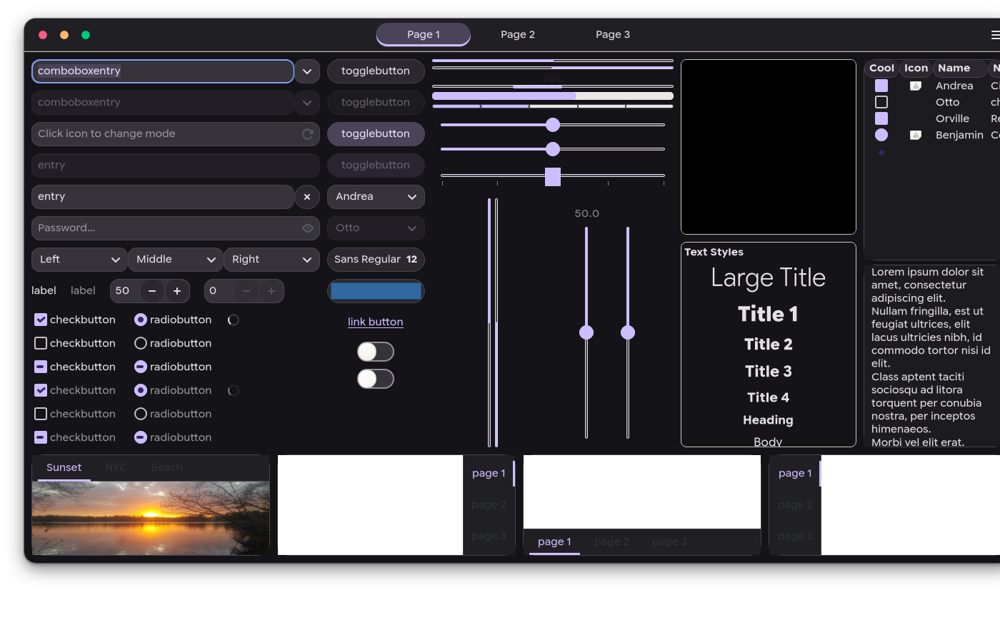

# Bun OS design: Material 3 end to end (Windows, Linux desktops, WebOS)

One token source, one artifact. The wallpaper gives the source colour, the M3 engine in Rust (`crates/aphrody-m3-tokens`,
the same MCU port behind `@aphrody/m3-tokens`) gives the 49 colour roles in light and dark, and
`m3-os-themes design` writes every desktop's theme, the window chrome, the icons and the fonts from it. The output is
a single receipt-verified directory on the build host, served through the fonts/CDN proxy.

| Piece          | Owner                                                                             |
| -------------- | --------------------------------------------------------------------------------- |
| Colour engine  | `crates/aphrody-m3-tokens` (wallpaper quantize + score, dynamic scheme, contrast) |
| Native half    | `crates/bunos-design` (`seed`, `theme`, parallel `render` of SVG to ICO/PNG)      |
| SVG raster/ICO | `crates/aphrody-svg` (`render_ico_windows`: DIB below 256 px, PNG 256 px)         |
| Generators     | `packages/m3-os-themes` (`design.ts`, `chrome.ts`, `icons.ts`, `desktops.ts`, existing Windows/GNOME/COSMIC/Chromium/app generators) |
| Icon source    | `vendor/material-design-icons` (aphrody-labs fork of Material Symbols, Apache-2.0) |
| Font source    | `vendor/fonts` (aphrody-labs fork of google/fonts, OFL-1.1) + Material Symbols variable fonts |
| Fonts on Windows | `packages/m3-fonts/scripts/windows-system-fonts.ts` |
| macOS-style references | `vendor/gtk-themes/whitesur`, `vendor/gtk-themes/mactahoe` (MIT, tag 2026-09-10), `vendor/hyprland/hyprland-plugins` (hyprbars, BSD-3-Clause) |

## Build, verify, publish (on `vps`)

```sh
cd ~/src/bun-os
APHRODY_BUILD_HOST=vps APHRODY_CARGO_TARGET_DIR=$HOME/build/storage/targets/design \
  systemd-run --user --scope --slice=build.slice scripts/aphrody/build/rust/cargo-serial.sh build --release --locked -p bunos-design
C=$(git rev-parse --short=12 HEAD); OUT=~/build/storage/artifacts/design/$C
bun packages/m3-os-themes/src/cli.ts design --out $OUT --bin ~/build/storage/targets/design/release/bunos-design
bun packages/m3-os-themes/src/cli.ts verify --dir $OUT           # every file against receipt.json
ln -sfn $OUT/icons ~/build/storage/artifacts/icons/$C           # icons/<commit> view
bun packages/m3-os-themes/src/cli.ts publish --dir $OUT          # -> https://cdn.aphrody.com/s/design/<path>
```

`--wallpaper <svg|png>` themes from another wallpaper, `--seed <hex>` skips extraction. A run takes about 20 s on
the 12-core host. The DLL is linked with `/Brepro`, so it is byte-reproducible. The fonts proxy
(`infra/config/host/systemd/aphrody/aphrody-fonts-proxy.service`) serves `~/apps/cdn/design/current` as a third
`--static` root, and `publish` switches that link atomically after checking the receipt.

Current artifact: `~/build/storage/artifacts/design/386aab0d12a7`, also reachable as `design/current` and
`icons/386aab0d12a7`. It holds 10,895 files: 148 ICO, 1,562 PNG, 9,059 SVG and 21 fonts, 163 MB in total.
`receipt.json` sha256 is `0d74782d…218d`. `bunos-icons.dll` is `63b06e1c…d1d2` unsigned and `34ce03f4…0de2` as signed
and installed on the workstation.

### Layout

```
theme/native-theme.json          Rust M3 export (schema 1, spec 2021): seed, variant, 49 roles x light/dark
wallpaper/                       Bun OS "Dusk" (SVG source, 3840x2160 and 1920x1080 PNG)
os/                              Windows (.theme, registry, DWM accent), GNOME, COSMIC, Chromium (existing generators)
gtk/BunOS-M3/                    GTK 3 + GTK 4/libadwaita theme (named colours, CSS variables, widgets, window chrome), settings.ini
gtk/gsettings.sh                 button layout (close,minimize,maximize:appmenu), fonts, icon theme
cosmic/                          BunOS-M3-{light,dark}.ron, com.system76.CosmicTk/v1/*, libcosmic-window-controls-start.patch
hyprland/bunos-m3-{light,dark}.conf  decoration, M3 Expressive animations, hyprbars traffic lights
omarchy/bunos-m3/                colors.toml, hyprland.conf, gtk.css, cosmic.ron, rio.toml, icons.theme (bunos-theme input)
rio/ nushell/                    terminal and shell palettes
webos/                           bunos-m3.css (--md-sys-*), chrome-{light,dark}.css, motion.css
chrome/spec.json                 the window chrome spec, resolved per mode, with its contrast checks
chrome/buttons/{light,dark}/     close|minimize|zoom x normal|hover|pressed|inactive|focus: SVG + PNG @24/30/36/48
windows/bunos-win11-chrome.{light,dark}.json   crates/bunos-win11-chrome `describe` shape (+ x-bunos extras)
icons/windows/ico/{light,dark}/  74 ICOs per mode (16 20 24 32 40 48 64 96 256)
icons/windows/bunos-icons.dll    icons-only resource DLL (no code, /noentry), light ordinals 100+, dark 1100+
icons/windows/icon-theme.json    id -> ordinal, shell index, known folder, extensions, drive, app; how to apply each
icons/freedesktop/Aphrody-M3[-Dark]/  index.theme, 16-256 PNG, scalable and symbolic SVG, Material catalogue (8,308 symbolic)
fonts/                           21 TTF, fonts.json (sha256, family, registry name, licence), licenses/, fontconfig/60-bunos-m3.conf
previews/                        spec renders of the window chrome on the wallpaper
receipt.json                     commit, inputs (seed, fork pins), counts, checks, sha256 + size of every file
```

## Colour: from the wallpaper to every surface

`bunos-design seed` decodes the wallpaper. It runs the MCU Celebi quantizer and score (`aphrody_m3_tokens::image`)
and returns `#5b45a2` for the default Dusk wallpaper. `bunos-design theme` expands that seed into the tonal-spot
scheme: dark `primary #cdbdff`, `surface #141318`, `surfaceContainer #201f24`; light `primary #63568f`. Every
generator then reads those roles, and none of them computes a colour of its own.

| Consumer | What it gets |
| -------- | ------------ |
| Windows | `os/windows`: AccentColor, AccentPalette (8 primary tones), ColorizationColor, a `.theme`. The DWM caption and border go to `crates/bunos-win11-chrome` as `windows/bunos-win11-chrome.<mode>.json`: `chrome.caption` = surfaceContainer, `chrome.border` = outlineVariant, `traffic.*` = harmonised signal hues, `dock.background` = surfaceContainerHigh, all as 0xRRGGBB `u32` exactly as `Rgb` serialises. `x-bunos` adds glyph, inactive, focus-ring and title colours, the 24 px hit area, the button names and the DWM corner (`DWMWCP_ROUND`). |
| COSMIC | ThemeBuilder RON (accent, bg, containers, window hint, corner radii) plus CosmicTk (Google Sans Flex / Google Sans Code, icon theme `Aphrody-M3`). |
| GNOME / GTK | libadwaita `@define-color` plus GTK 4.16+ `--accent-bg-color`-style variables, explicit widget rules for the GTK Default theme, GNOME Shell CSS, gsettings (accent-color is the nearest libadwaita accent). |
| Hyprland | border, shadow, blur and hyprbars colours; Omarchy `colors.toml` (accent, surfaces, ANSI 0-15) for `bunos-theme`. |
| Rio, nushell | palettes from the dark roles, with green and yellow harmonised towards the primary. |
| WebOS site | `webos/bunos-m3.css` (`--md-sys-color-*`, shape, type), chrome and motion custom properties with reduced-transparency, forced-colours and reduced-motion fallbacks. |

### M3 Expressive: shape and motion

- Shape: window corner = `md.sys.shape.corner.large` (16 px). The corner scale (4/8/12/16/28 px, full) comes from
  `m3-tokens.css`, which is generated from the Rust crate. Buttons and chips are full-round. Folder, file and app plates
  use 56-64 px corners on a 256 grid, the M3 Expressive "squircle-ish" app shape.
- Motion: spatial springs from `EXPRESSIVE_SPRINGS` (fast 0.6/800, default 0.8/380, slow 0.8/200), as cubic-bezier
  approximations for the toolkits that have no spring:

  | Token | Duration | Curve |
  | --- | --- | --- |
  | spatial fast | 350 ms | (0.42, 1.67, 0.21, 0.90) |
  | spatial default | 500 ms | (0.38, 1.21, 0.22, 1.00) |
  | spatial slow | 650 ms | (0.39, 1.29, 0.35, 0.98) |
  | effects fast | 150 ms | (0.31, 0.94, 0.34, 1.00) |
  | effects default | 200 ms | (0.34, 0.80, 0.34, 1.00) |
  | effects slow | 300 ms | (0.34, 0.88, 0.34, 1.00) |

  Exits run at 65 % of the enter duration. On Hyprland, windowsIn uses spatial default with popin 88 %, windowsOut runs
  at 325 ms, and windowsMove uses spatial fast.
- Elevation: one scale (M3 levels 0-5 = 0/1/3/6/8/12 dp), drawn as a two-layer key + ambient shadow. Active windows
  sit at level 4, inactive ones at level 2.

## Window chrome

The look is macOS-style window controls on top of M3. Three traffic-light buttons sit on the left in the order close,
minimise, zoom, with glyphs on hover and on focus, and grey when the window is inactive. Windows get rounded corners
and soft layered shadows. Translucent materials are used only on chrome: title bar, sidebar, dock and panels. Everything
else (colour roles, type, shape, motion) is M3. All of it is our own artwork: plain circles and stroked glyphs drawn in
`chrome.ts`. No Apple asset, SF font or icon is used. The signal hues (`#ff5f57`, `#febc2e`, `#28c840`) are generic
red, amber and green, harmonised towards the theme primary with MCU harmonize (at most 15 deg of hue rotation). For the
Dusk theme in dark mode that gives close `#fd5b82`, minimise `#ffb96d` and zoom `#00c77e`.

The reference projects are forked and pinned:

- **WhiteSur** and **MacTahoe** GTK themes (vinceliuice, MIT): the most complete macOS GTK and GNOME Shell themes,
  with left-header-button variants and libadwaita support. They are Sass-only, so building them needs `sassc` in the
  Arch package builder. Bun OS takes their structure (window-control selectors, decoration shadows, header-bar
  geometry) and generates its own CSS from the M3 roles, because their palettes are fixed accent lists.
  WhiteSur-icon-theme is GPL-3.0 and is not used: the icons are Material Symbols.
- **hyprbars** (hyprwm/hyprland-plugins, BSD-3-Clause): title bars with left-aligned buttons
  (`bar_buttons_alignment = left`), `icon_on_hover`, `inactive_button_color`, and blur, which is everything the spec
  needs. Newer Hyprland title-bar plugins add nothing the spec needs, so hyprbars it is. The desktop agent already
  packages it (`hyprland-plugin-hyprbars`).
- **COSMIC**: libcosmic draws header-bar controls at the end only, as symbolic icons (`window-*-symbolic`). The patch
  `packages/m3-os-themes/patches/libcosmic-window-controls-start.patch` (against `vendor/cosmic-epoch/libcosmic`
  de9353ab; `git apply --check` is clean) adds a CosmicTk key `window_controls_start`. When it is set, the controls go
  at the start in macOS order and use the full-colour `window-close`, `window-minimize` and `window-maximize` icons
  from the `Aphrody-M3` icon theme, at 12 px inside a 24 px hit area.
- **Windows**: `crates/bunos-win11-chrome` sets the DWM attributes (rounded corners, Mica, immersive dark, caption and
  border colours) from `windows/bunos-win11-chrome.<mode>.json`. The frame owner draws the caption buttons from
  `chrome/buttons/<mode>/*.png` (24, 30, 36 and 48 px for 100-200 % scale). GlazeWM (`vendor/glazewm`, GPL-3.0) tiles
  and keeps the DWM chrome.

Screenshots:

- GTK 4, rendered headless on `vps` (gtk4-broadwayd + headless Chrome, `gtk4-widget-factory` with
  `gtk/BunOS-M3/gtk-4.0`): [dark](design/screenshots/gtk4-widget-factory-dark.png) and
  [light](design/screenshots/gtk4-widget-factory-light.png). The traffic lights are on the left, the window corner is
  rounded with soft shadows, and the type is Google Sans Flex.
- Spec render of the chrome on the wallpaper, drawn by `bunos-design`: [dark](design/screenshots/chrome-spec-dark.png)
  and [light](design/screenshots/chrome-spec-light.png). This is the reference that the Windows and Hyprland renderings
  follow.



### Acceptance checklist

| # | Requirement | GTK 3/4 | Hyprland | COSMIC | Windows | WebOS |
| - | ----------- | ------- | -------- | ------ | ------- | ----- |
| 1 | Translucency only on chrome, never under content | header bar opaque (GTK has no blur-behind) | blur on hyprbars, waybar and walker layers only | opaque (cosmic-comp has no blur) | Mica on the caption (system material) | `--bunos-chrome-*-bg` only on chrome elements |
| 2 | Opaque fallback for reduce-transparency / high contrast | always opaque | `bar_blur` off and `bar_color` alpha 1 when the session asks | always opaque | Mica falls back to solid when transparency effects are off or contrast themes are on (DWM) | `@media (prefers-reduced-transparency), (forced-colors)` |
| 3 | Accessible names Close / Minimise / Zoom (UIA / AT-SPI) | GTK window controls expose them | hyprbars buttons have no AT-SPI names (compositor-drawn): gap, the client CSD title stays accessible | libcosmic buttons; the patch keeps them as buttons | the frame owner must set UIA names from `x-bunos.names`: owner `bunos-win11*` | `<title>` in the SVG plus aria-label |
| 4 | Visible keyboard focus ring at 3:1 against the title bar | `:focus-visible` outline, primary: 5.55:1 light, 9.6:1 dark | n/a (no keyboard focus on compositor bars) | libcosmic focus style | ring art in `*-focus.png` | `--bunos-chrome-focus` |
| 5 | Hit area at least 24x24 around a 12 px circle | min-width/height 24 px | button size 14 px + 8 px padding: below 24, a hyprbars limit | patch: 12 px icon + 6 px padding = 24 | 24 px buttons in the art and in `x-bunos.hit` | 24 px tokens |
| 6 | Glyphs on hover and on keyboard focus, not hover-only; colour never the only cue | `windowcontrols:hover` and `:focus-visible` | `icon_on_hover` (no keyboard path) | glyphs always shown (a static icon cannot react to hover) | hover and focus art | hover and focus states |
| 7 | Inactive = neutral grey with 3:1 boundary | `:backdrop`: surfaceContainerHighest + outline, 3.88:1 (light) | `inactive_button_color` | via COSMIC focus state | `x-bunos.inactive` | `--bunos-chrome-inactive*` |
| 8 | M3 Expressive springs; exit 60-70 % of enter; interruptible; reduced motion respected | 150 ms effects curve; GTK honours `gtk-enable-animations=false` | spatial curves, exit 65 %, `animations:enabled=false` | cosmic-comp's own animations | DWM animations follow "Animation effects" | `motion.css` + `prefers-reduced-motion` |
| 9 | One elevation scale and one corner radius everywhere; DWM nearest corner | 16 px + level 4/2 shadows | `rounding = 16`, shadow range 24 / offset 8 | `corner_radii` from the M3 scale | `DWMWCP_ROUND` (8 px, the nearest of 4/8) | `--bunos-chrome-radius` |
| 10 | Title text at least 4.5:1 on the translucent material, over light and dark wallpapers, both themes | pass | pass | pass | pass | pass |

Row 10 is computed, not estimated. `chrome.ts` composites each material over white and black wallpapers and raises its
alpha until `onSurface` reaches 4.5:1. The results are recorded in `chrome/spec.json` and `receipt.json` `checks`.
Light theme: 15.22 and 8.77 (translucent), 14.74 (opaque). Dark theme: 6.21 (white wallpaper) and 13.72 (black wallpaper) translucent, 12.71 opaque; inactive boundary 5.17, focus ring 9.6. All glyph-on-button
pairs are at least 3:1 (lowest: close in light, 3.72). The design run fails if any check fails.

Open gaps: compositor-drawn bars (hyprbars) have no accessibility names and no keyboard focus, and the hyprbars hit area
is smaller than 24 px. The accessible path on Hyprland is client-side decorations (GTK/COSMIC CSD with the same
chrome). On Windows, the frame owner has to publish the UIA names.

## Icons

There is one mapping, `ICONS` in `packages/m3-os-themes/src/icons.ts`, with 110 entries:

- 23 folders: known folders by KNOWNFOLDERID name, generic folder, trash
- 20 file types, with extension lists
- 7 drives including This PC, with shell indices 7/8/9/11/12/15
- 24 Bun OS apps
- 36 monochrome UI glyphs

Each entry maps to Material Symbols Rounded, weight 400, filled, composed with the theme roles:

- Folders: two-tone primary body with the symbol as an overlay.
- Files: page with a folded corner and the symbol in a category hue.
- Drives: neutral plate.
- Apps: rounded plate in the hue's container tone with the on-container glyph.

Sizes of 24 px and below use simplified artwork (no overlay). Fixed hues (blue, green, orange and so on) are
harmonised towards the primary, so the set follows the wallpaper.

**Windows**

- ICOs in the Windows shell layout: 32-bit DIB at 16/20/24/32/40/48/64/96 and PNG at 256.
- `bunos-icons.dll` holds icons only: no code, no entry point, a VERSIONINFO block. It is Authenticode-signed on the
  workstation with `factory/windows/signing/test-signing.ps1 sign` and installed as
  `%SystemRoot%\BunOS\icons\bunos-icons.dll`.
- `icon-theme.json` gives `<dll>,-<ordinal>` per id and says how to apply each kind:
  - `Explorer\Shell Icons` for generic folders, files and drives
  - `desktop.ini` `IconResource` for known folders
  - `DefaultIcon` only for ProgIDs Bun OS owns
  - `DriveIcons\<Letter>` for drives
  - `.lnk` IconLocation / RelaunchIconResource for Start and taskbar
- Applying the mapping belongs to the shell agent (docs/WINDOWS-SHELL.md). This pipeline does not write any of those
  keys.

**Linux**

- Freedesktop themes `Aphrody-M3` and `Aphrody-M3-Dark` (which inherits `Aphrody-M3`, then Cosmic, Adwaita and hicolor).
- Fixed 16-256 PNG, scalable SVG, `-symbolic` SVG in `#bebebe`, and the whole Material catalogue as symbolic icons
  under `material/`.
- COSMIC, GNOME and Hyprland/Omarchy all select it (`icon_theme`, gsettings `icon-theme`, `icons.theme`).

Licence: Material Symbols are Apache-2.0, (c) Google LLC. `icons/LICENSE-material-symbols.txt` and `icons/NOTICE.txt`
(with the fork commit) travel with the artifact, and the DLL's VERSIONINFO carries the copyright line.

## Fonts

`vendor/fonts` is the aphrody-labs fork of google/fonts, at commit `9710da1e`; the build host has a full checkout. It is
used instead of the Google Fonts API because the API serves WOFF2 subsets for browsers. Desktop installs need the
upstream variable TTFs with their OFL files and pinned hashes, which only the repository has, and the fork is already
there.

**Google Sans Flex** is openly licensed: OFL-1.1 in `ofl/googlesansflex`, with axes GRAD, ROND, opsz, slnt, wdth and
wght. It is the brand and UI face.

| Role | Families |
| ---- | -------- |
| Brand / UI | Google Sans Flex |
| Plain | Roboto Flex |
| Serif | Roboto Serif (+ italic) |
| Code | Google Sans Code (+ italic), Roboto Mono (+ italic) |
| Coverage | Noto Sans, Noto Serif, Noto Sans Mono, Noto Sans JP, Noto Sans Symbols 1/2, Noto Sans Math |
| Emoji | Noto Color Emoji |
| Icon fonts | Material Symbols Outlined, Rounded, Sharp (Apache-2.0) |

That is 21 files. `fonts/fonts.json` records the sha256, licence and registry name of each.

**Served.** The Google Fonts CSS2 API was already proxied by `aphrody-fonts-proxy` (`cdn.aphrody.com/css2?family=Google+Sans+Flex`).
The desktop TTFs are now also served at `https://cdn.aphrody.com/s/design/fonts/<file>`; for example
`GoogleSansFlex-Variable.ttf` returns 200, `font/ttf`, 4,153,392 bytes, sha256 `c31a482f…b6fe`.

**Windows (per machine).** `sudo bun packages/m3-fonts/scripts/windows-system-fonts.ts install <artifact>/fonts`:

- It checks each sha256, then copies the file into `%SystemRoot%\Fonts` and adds the
  `HKLM\...\Windows NT\CurrentVersion\Fonts` value, then calls AddFontResource and broadcasts WM_FONTCHANGE.
- An existing file with different bytes, or a value already registered elsewhere, is kept and reported: no Windows font
  is ever overwritten.
- What it added is recorded in `%ProgramData%\BunOS\fonts\installed.json`, so `uninstall` removes exactly that.
- `status` checks file and registration.
- It was run on the workstation and added all 21 families, with no conflicts.

**Distro.** The TTFs go in `/usr/share/fonts/bunos-m3/`, plus `fonts/fontconfig/60-bunos-m3.conf` in `/etc/fonts/conf.d/`.
That config makes Google Sans Flex the default for sans-serif and system-ui, Roboto Serif for serif, Google Sans Code for
monospace, and Noto for coverage and emoji. The desktop agent installs both from the artifact.

## Reference captures and interface analysis

The references are in [docs/design/references/](design/references/README.md), with the source URL, date, credit and
licence of each file in `SOURCES.json`. They are design references only: never shipped, and excluded from every build.

- Android 17 desktop: 7 images from developer.android.com (CC BY 4.0).
- Googlebook: 8 images. Three are Google Keyword renders and screenshots; four are 9to5Google review screenshots; one is
  an Android Authority photo of the screen. All rights stay with their owners.

**Googlebook is a real product.** Google announced it on 2026-05-12 as Gemini-centred laptops "built on part of the
Android tech stack", combining Android and ChromeOS. It is made by Acer, ASUS, Dell, HP and Lenovo, and succeeds the
Chromebook line. It went on sale on 2026-10-04 in the US, from $899, running "Googlebook OS" with up to 10 years of
updates. The press codename "Aluminium OS" is not used by Google.

Own captures from the official Android 17 desktop emulator image were attempted on `vps`. The image is
`system-images;android-37.1;android-desktop;x86_64`, build CLE3.260929.004, run headless with emulator 37.3.6.0, KVM
and the `desktop_large` profile at 1920x1080. The script is `~/build/out/design/android-desktop.sh`. The image
installs and boots, but no capture path worked:

- With `swiftshader_indirect`, the guest `screencap` aborts on the gfxstream assertion
  `!rcEnc->featureInfo()->hasReadColorBufferDma`.
- Disabling GLDMA/GLDMA2, or using `-gpu guest`, makes system_server abort in the same assertion on its display
  thread, so the boot never completes.
- `-gpu swangle_indirect` does not complete the boot.
- The host-side `emu screenrecord screenshot` writes nothing without a window.

What remains open is a host-side capture through the emulator gRPC `getScreenshot` (`-grpc`), or a GPU-backed host.
Until then, the published Android Developers images above are the Android desktop reference.

### What Android 17 desktop and Googlebook OS do

- **Layout.** A full-width opaque taskbar runs along the bottom. From the left: launcher button, divider, pinned and
  running apps as round icons with a dash indicator, then Gemini after a second divider. The icon group is centred
  (QPR1 moved it left). The status cluster sits on the right: time and date, notifications, a pill with the status
  icons. On Googlebook the clock is at the top left and the notification bell at the top right.
- **Window chrome.** The header shows the app icon, the name and a chevron menu on the left, and minimise, maximise and
  close as thin line glyphs with no button backgrounds on the right. The header is tinted from the app's colour (a
  dark container tone). Corners are large (about 16 dp) on all four sides. Apps can draw into the header, as Chrome
  does with its tabs.
- **Launcher.** It is a floating rounded panel anchored bottom-left: a pill search field ("Search apps from <phone>")
  above a 4-column grid of round icons with labels. Long-press or right-click opens stacked rounded cards (app info,
  split, pin, widgets, shortcuts).
- **Density.** Pointer-first: smaller targets, hover states, right-click menus, multi-pane layouts. Quick Settings is a
  floating Pixel-style panel with pill sliders and rounded-rectangle tiles, filled with primary when on.
- **Type scale.** Google Sans Flex throughout, with M3 title-medium in headers and body-medium in lists.
- **Colour.** Dynamic Color from the wallpaper tints the whole shell (taskbar, panels, widgets, headers).
- **Motion and M3 Expressive cues.** Pills everywhere, "cookie" shape masks, large tiles, translucent widgets, the
  Magic Pointer floating pill, and springy panel motion.

### What Bun OS adopts (Windows and Linux), mapped to tokens

| Element | Adopt | Token / file |
| ------- | ----- | ------------ |
| Taskbar / dock | full-width bottom bar, centred icon group, launcher button at the start, divider, Gemini at the end, running-dot indicator | `surfaceContainer` bar, `secondaryContainer` running indicator, 48 px icons (`dock.icon_size`), `corner.full` pills |
| Launcher | floating panel anchored bottom-left above the taskbar, pill search, 4-column labelled grid | `surfaceContainerHigh` at material alpha 0.70 + blur 40 (dock material), `corner.extra-large` (28), label-medium |
| Window header | keep the M3 header (title-medium, 40 px, app icon + name at the start) but use traffic lights instead of Android's right-side line glyphs, per the owner's macOS direction; the header tint follows `surfaceContainer`, not per-app colour, so all windows match | `chrome/spec.json`, `GEOMETRY.titlebarHeight` 40, `corner.large` 16 |
| Corners and shadow | about 16 dp on all four corners, soft large shadow, which matches Android desktop | `GEOMETRY.radius` 16, elevation 4/2 |
| Quick settings | floating panel at the top right (Linux) or the Windows flyout restyled: pill sliders, primary-filled tiles | `primary` / `onPrimary`, `corner.large` tiles, spatial-default spring |
| Density | desktop density: 24 px hit targets in chrome, 32-40 px list rows, hover states | M3 density -1/-2 |
| Type | Google Sans Flex UI, Google Sans Code mono | `fonts/`, CosmicTk, gsettings, fontconfig |
| Colour | wallpaper-derived scheme on every surface, applied to every desktop from one run | `theme/native-theme.json` |
| Motion | spatial springs for windows and panels, effects curves for fades, reduced motion honoured | `motion.css`, Hyprland `animations`, GTK transitions |

Handoff: the shell agent applies `icons/windows/icon-theme.json`; `crates/bunos-win11-chrome` consumes the chrome JSON
and caption-button art; the desktop-merge agent packages `gtk/BunOS-M3`, `cosmic/`, `hyprland/`, `omarchy/bunos-m3`,
the freedesktop icon themes, the fonts and the fontconfig rule, and applies the libcosmic patch in its pin.
