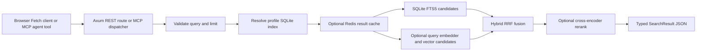

# Aphrody Search Server Architecture

This document records the behavior established by the current Aphrody source
tree. It describes Aphrody only; private Perplexity internals are not part of
this inspection. Recheck the route and feature notes when changing the server.

## Process and network boundary

`aphrody mcp-server http` starts the Axum HTTP mode in
`crates/aphrody-mcp/src/lib.rs`. The listener rejects non-loopback bind
addresses. Its router mounts Streamable HTTP MCP at `/mcp` and merges the REST
router owned by `crates/aphrody-mcp/src/http_rest.rs`.

The `/mcp` service has a required Bearer middleware. It reads
`APHRODY_MCP_HTTP_TOKEN`, then the configured Aphrody AI HTTP token; invalid or
missing credentials fail closed. REST routes and `/healthz` are outside that
middleware. The RAG REST route therefore relies on the loopback bind plus an
authenticated reverse proxy before an operator exposes it to another host.
Do not point a public browser directly at the MCP listener.

| Route | Owner and behavior | Access boundary |
| --- | --- | --- |
| `GET /healthz` | Basic process liveness | Loopback listener; no token |
| `POST /mcp` and Streamable HTTP methods | MCP tool server | Bearer middleware |
| `GET /api/v1/rag/search?q=...&limit=8&path_prefix=...` | Canonical local SQLite search; compiled only with feature `rag` | REST router, no route-level auth; loopback and authenticated proxy are required |
| `GET /api/v1/rag/query` | Legacy keyword search against `aphrody_rag_documents` in PostgreSQL | REST router; same proxy boundary |
| `GET /api/v1/rag/stats` | Legacy PostgreSQL corpus counts | REST router; same proxy boundary |
| `GET /api/v1/aphrody/status`, `/api/v1/models`, `/v1/models` | Status and model inventory | REST router; same proxy boundary |

The canonical browser endpoint and MCP `aphrody_rag_search` tool call the same
`rag_tools::run` function. The legacy `/rag/query` route is a separate
PostgreSQL compatibility path and does not invoke the hybrid SQLite pipeline.

## Search request path

The route accepts a non-empty `q`, `limit` from 1 through 50 (default 8), and
an optional path prefix. The RAG tool resolves the database in this order:
`APHRODY_RAG_DB`, an existing Aphrody agent-home database, then
`~/.aphrody/rag/index.db`. It refuses to silently create an empty index.

The SQLite schema owns `docs`, `chunks`, an FTS5 `chunks_fts` virtual table,
dense `vectors`, and model metadata. FTS5 indexes content, heading, and symbol
with Unicode tokenization and diacritic removal. The search pipeline supports
lexical, vector, and hybrid retrieval; MCP requests default to hybrid. If no
embedder is configured or available, it serves lexical results and records a
`fallback_reason`. A configured reranker may reorder the fused candidates;
reranker failures keep retrieval order and are also reported as a fallback.
The JSON result contains query, ranked chunk hits, served mode, fallback
reason, elapsed time, and candidate count. Hits carry local document paths,
text ranges, content, score, and retrieval channel; this is not yet a public
web SERP result with source URLs and inline citations.

## Cache behavior

The MCP search path checks `APHRODY_REDIS_URL`, then `REDIS_URL`. The cache
key incorporates the index path and SQLite/WAL size and modification time,
query, result limit, path prefix, and hashed provider settings. Successful
results are cached for 60 seconds; Redis failure degrades to an uncached
search. The current RESP client supports unauthenticated loopback Redis only;
it disables unsupported credentials, TLS, and non-loopback hosts. This is a
single-host cache design, not a remote managed-Redis integration.

## Indexing entry points

- `aphrody rag index <directory>` builds or refreshes the local content index.
- `aphrody rag web-ingest <url>` fetches one page and ingests its extracted
  Markdown into the configured RAG backend (when the selected backend and
  feature configuration support ingestion).
- `aphrody web crawl-index ...` is the bounded crawl-to-index workflow exposed
  by the Web CLI.
- `aphrody_rag_search` and `aphrody_rag_context` expose the index to MCP agents.
- `@aphrody/web-crawl/browser` calls the loopback REST route through a browser
  same-origin URL or configured gateway. It does not put server credentials in
  browser code.
- The Rust `aphrody-web` crate provides in-process crawl and local search
  surfaces, plus the typed HTTP client described in its README.

## Gaps against an agent-facing web search product

The existing stack already has recursive crawling, page extraction, a local
lexical/vector/hybrid index, cache support, MCP tools, REST access, and Rust
and JavaScript wrappers. Source inspection establishes these gaps for the
current web search contract:

1. The public `/rag/search` endpoint searches the local corpus only. There is
   no unified public-web Search API that returns ranked web URLs and extracted
   content directly to external agents.
2. Search hits expose local paths and chunks, not a stable external source
   record with canonical URL, title, publisher, publication time, and citation
   identity for generated answers.
3. Query, retrieval, answer synthesis, source verification, and follow-up
   context are separate or absent from this endpoint. It returns retrieval
   results, not a cited answer or deep-research report.
4. REST route authentication is an operator/reverse-proxy responsibility;
   browser support requires a deployment-specific same-origin or authenticated
   gateway arrangement.
5. Redis cache transport is limited to unauthenticated loopback Redis. It has
   no TLS, AUTH, pooling, or cluster behavior in this client.
6. The route selects one profile-level SQLite index from server environment
   and local home state. It does not expose per-request tenant, collection, or
   authorization scopes for hosting multiple independent corpora behind one
   shared service.

These are implementation gaps, not claims about Perplexity's private design.
Potential design directions should be compared against public API documentation
and Aphrody's own service requirements.

## Source map

- Server composition and loopback bind: `crates/aphrody-mcp/src/lib.rs`
- HTTP routes and response behavior: `crates/aphrody-mcp/src/http_rest.rs`
- MCP Bearer middleware: `crates/aphrody-mcp/src/http_auth.rs`
- Shared MCP/REST RAG entry point and Redis cache key: `crates/aphrody-mcp/src/rag_tools.rs`
- SQLite schema and retrieval pipeline: `crates/aphrody-rag/src/schema.rs`,
  `crates/aphrody-rag/src/store.rs`, `crates/aphrody-rag/src/search.rs`
- Redis RESP implementation: `crates/aphrody-rag/src/redis_cache.rs`
- CLI RAG operations: `crates/aphrody-command/src/rag_cmd.rs`
- Browser client: `packages/aphrody-web/src/browser.ts`
- Rust package guide: `crates/aphrody-web/README.md`
