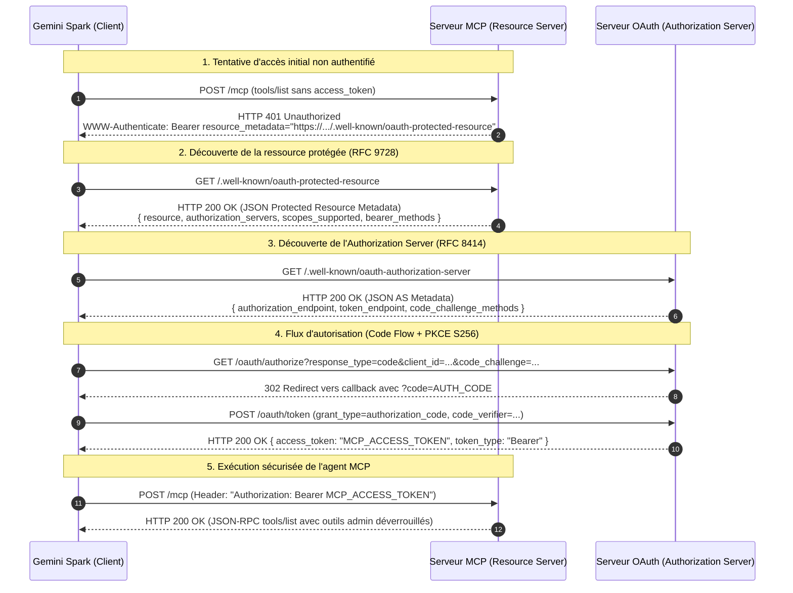

<!-- SPDX-License-Identifier: Apache-2.0 -->
# Spécification Technique de Référence : Google Gemini Spark & Connecteurs MCP OAuth

> **Document de Référence & Architecture Système**  
> **Auteur :** Lead Autonomous System Engineer (Aphrody Core Engine)  
> **Date de rédaction :** 12 Septembre 2026  
> **Cible :** `docs/research/ai/research/gemini-spark-spec.md`  
> **Statut :** Spécification technique consolidée (Production-Ready)  
> **Périmètre :** Google Gemini Spark (Agent Mode), Connecteurs MCP Distants & Locaux, Découverte OAuth 2.0 (RFC 8414 & RFC 9728), et Convergence Codebase (`crates/ai/mcp`, `crates/google/gemini-runtime`, `crates/google/antigravity`).

---

## Table des Matières

1. [Introduction & Contexte Exécutif](#1-introduction--contexte-exécutif)
2. [Gemini Spark : L'Environnement de Travail Agentique](#2-gemini-spark--lenvironnement-de-travail-agentique)
   - 2.1 [Identité Produit & Définition de Spark](#21-identité-produit--définition-de-spark)
   - 2.2 [Empreinte DOM, CSS & Télémétrie Frontend](#22-empreinte-dom-css--télémétrie-frontend)
   - 2.3 [Écosystème Outillage & IDE Antigravity (Jetski / Cortex)](#23-écosystème-outillage--ide-antigravity-jetski--cortex)
3. [Les 4 Formats d'Intégration d'Outils Externes sous Gemini](#3-les-4-formats-dintégration-doutils-externes-sous-gemini)
   - 3.1 [Model Context Protocol (MCP)](#31-model-context-protocol-mcp)
   - 3.2 [Gemini Function Calling (API Natif)](#32-gemini-function-calling-api-natif)
   - 3.3 [Google Extensions & Manifestes Plugins](#33-google-extensions--manifestes-plugins)
   - 3.4 [Webhooks & Abonnements Asynchrones](#34-webhooks--abonnements-asynchrones)
   - 3.5 [Matrice Comparative des Protocoles](#35-matrice-comparative-des-protocoles)
4. [Architecture OAuth 2.0 / MCP Google Spark : Découverte et Négociation Dynamique](#4-architecture-oauth-20--mcp-google-spark--découverte-et-négociation-dynamique)
   - 4.1 [Diagramme de Séquence de Connexion Sécurisée](#41-diagramme-de-séquence-de-connexion-sécurisée)
   - 4.2 [Spécification RFC 9728 (OAuth 2.0 Protected Resource Metadata)](#42-spécification-rfc-9728-oauth-20-protected-resource-metadata)
   - 4.3 [Spécification RFC 8414 (OAuth 2.0 Authorization Server Metadata)](#43-spécification-rfc-8414-oauth-20-authorization-server-metadata)
   - 4.4 [Schéma de Nommage Google des Client IDs User-Bound](#44-schéma-de-nommage-google-des-client-ids-user-bound)
5. [Exploration du Code Source Existant & Points de Convergence](#5-exploration-du-code-source-existant--points-de-convergence)
   - 5.1 [Crate `crates/ai/mcp` (`aphrody-mcp`)](#51-crate-cratesgoogle_mcp-aphrody-mcp)
   - 5.2 [Crate `crates/google/gemini-runtime`](#52-crate-cratesgemini-runtime)
   - 5.3 [Crate `crates/google/antigravity`](#53-crate-cratesantigravity-sdk)
   - 5.4 [Blueprint de Convergence & Passerelle Unifiée](#54-blueprint-de-convergence--passerelle-unifiée)
6. [Références Normatives, Spécifications & URLs](#6-références-normatives-spécifications--urls)

---

## 1. Introduction & Contexte Exécutif

L'évolution de l'écosystème d'intelligence artificielle de Google a conduit à l'introduction d'environnements d'exécution agentiques capables de chaîner de manière autonome des tâches de longue haleine, de formuler des plans d'action et d'interagir avec des services externes.

Dans l'interface web grand public et professionnelle `gemini.google.com/app`, ce mode agentique est identifié sous le nom commercial **Gemini Spark** (accompagné du slogan *« Put Gemini Spark to work for you »*). Parallèlement, l'outillage développeur et IDE de Google a cristallisé ces mécanismes dans la suite **Antigravity** (IDE Antigravity, CLI `agy`, extensions Jetski et backend Go `cortex`).

Pour permettre à Gemini Spark d'agir sur des systèmes tiers tout en respectant les frontières de sécurité de l'entreprise et les droits utilisateurs, Google adopte deux protocoles majeurs :
1. **Model Context Protocol (MCP)** : Standard industriel de description et d'exécution d'outils, de ressources et de prompts par JSON-RPC 2.0 sur Streamable HTTP et `stdio`.
2. **Négociation OAuth 2.0 Dynamique** : Basée sur **RFC 8414** (Authorization Server Metadata) et la récente norme **RFC 9728** (Protected Resource Metadata, avril 2025), garantissant qu'un agent autonome peut découvrir les points de terminaison de sécurité d'un serveur MCP distant, négocier les scopes requis, et authentifier l'utilisateur sans clé en dur.

Ce document fournit la spécification technique intégrale de ces technologies, documente les endpoints réels et les formats de paquets, et formalise le pont d'ingénierie avec les crates Rust de notre monorepo.

---

## 2. Gemini Spark : L'Environnement de Travail Agentique

### 2.1 Identité Produit & Définition de Spark

**Gemini Spark** constitue l'espace de travail agentique (« Agent Mode ») intégré à l'application web Google Gemini. Contrairement au mode de conversation classique (question/réponse en un tour) ou au mode de recherche documentaire simple, Spark opère comme un agent autonome à boucle fermée :

- **Planification & Décomposition :** Formulation d'un plan d'étapes hiérarchique avec suivi d'état.
- **Exécution d'Outils Multi-Tours :** Capacité d'invoquer séquentiellement ou en parallèle des connecteurs d'outils (MCP, extensions Workspace, exécution de code).
- **Auto-Correction & Vérification :** Évaluation des résultats intermédiaires avant consolidation du rapport final.
- **Persistance & Trajectoires :** Enregistrement des trajectoires agentiques pour replay, audit et fine-tuning de politiques d'actions.

### 2.2 Empreinte DOM, CSS & Télémétrie Frontend

L'inspection statique et dynamique des bundles de `gemini.google.com/app` (cf. l'audit historique référencé en fin de document) révèle la signature structurelle exacte de Spark :

#### Sélecteur de Navigation Principal
```html
<button _ngcontent-ng-c3641684704=""
        data-test-id="app-tab-agent"
        theme="lm"
        gemtooltipposition="below"
        class="mat-mdc-tooltip-trigger app-tab app-tab--active mat-mdc-tooltip-disabled lm-enabled">
  <div _ngcontent-ng-c3641684704="" class="agent-tab-content">
    <span _ngcontent-ng-c3641684704="" class="gds-body-s">Spark</span>
    <span _ngcontent-ng-c3641684704="" data-test-id="beta-badge" class="beta-badge">beta</span>
  </div>
</button>
```

#### Identifiants Clés
- **Onglet DOM :** `button[data-test-id="app-tab-agent"]`
- **Conteneur d'affichage :** `.agent-tab-content`
- **Libellé de marque :** `Spark` avec badge `beta`
- **Variables CSS dédiées :**
  - `--gemini-sparkle` : `linear-gradient(135deg, #4285f4 0%, #9168c0 50%, #ec4899 100%)` (l'affordance de marque unique Gemini)
  - Classes de structure : `.gemini-spark`, `.gemini-spark-header`

#### Points d'Entrée Backend Boq / RPC
L'orchestration web s'appuie sur le protocole `batchexecute` vers les services internes :
- `assistant.lamda.ContextualDiscoveryInfo.DiscoveryFeature`
- `assistant.lamda.DeepResearchMetadata.DeepResearchIntent` (moteur de recherche approfondie)
- `assistant.lamda.ImmersivesMetadata.ImmersivesIntent`
- Feature flags UI identifiés : `disable_scheduled_actions_mobile_notification_snackbar`, `disable_skills_migration_card`, `disable_extensions_discovery_dialog`.

### 2.3 Écosystème Outillage & IDE Antigravity (Jetski / Cortex)

Gemini Spark dans le navigateur partage son infrastructure sous-jacente avec la déclinaison développeur Google :

```
┌─────────────────────────────────────────────────────────────┐
│                    Google Gemini Ecosystem                  │
├───────────────────────────────┬─────────────────────────────┤
│      Web Surface (Consumer)   │      Developer Surface      │
│      gemini.google.com/app    │    Antigravity IDE & CLI    │
├───────────────────────────────┼─────────────────────────────┤
│  Spark (Agent Mode)           │  Jetski Webview (UI)        │
│  data-test-id="app-tab-agent" │  Cascade Agent Engine       │
│  assistant.lamda.* RPCs       │  Cortex Language Server     │
├───────────────────────────────┴─────────────────────────────┤
│                     Common Backend Core                     │
│  • Cloud Code Private API: cloudcode-pa.googleapis.com      │
│  • Model Family: Gemini 3.8 Flash, 3.5 Flash, 3.1 Pro       │
│  • Tool Layer: Model Context Protocol (MCP) + OAuth 2.0     │
└─────────────────────────────────────────────────────────────┘
```

Comme documenté dans notre reverse-engineering [antigravity-ide-re.md](./antigravity-ide-re.md) :
- **Antigravity IDE** est un fork de Windsurf / Codeium.
- Le cœur agentique réside dans un binaire Go natif de ~133 Mo : `language_server_windows_x64.exe` (nom de code **Cortex**, moteur **Cascade**, proto interne `exa.*`).
- Le schéma de configuration MCP porte la note source interne :  
  `$comment: Keep in sync with google3/third_party/jetski/cortex/utils/mcp/config.schema.json`.
- Le backend distant expose les méthodes RPC `v1internal:*` sur `cloudcode-pa.googleapis.com`, notamment `internalAtomicAgenticChat` (la boucle d'exécution agentique) et `generateContent`.

---

## 3. Les 4 Formats d'Intégration d'Outils Externes sous Gemini

Gemini et l'infrastructure Google disposent de quatre mécanismes distincts pour interconnecter des capacités externes.

### 3.1 Model Context Protocol (MCP)

Le **Model Context Protocol** (créé initialement par Anthropic en novembre 2024 et devenu le standard ouvert de l'industrie) est le protocole de premier ordre adopté par Gemini Spark pour les connecteurs tiers personnalisés.

- **Protocole :** JSON-RPC 2.0.
- **Version courante du protocole :** `2024-11-05`.
- **Transports supportés :**
  - `Streamable HTTP` : Requêtes HTTP POST avec framing JSON ou flux Server-Sent Events (`text/event-stream`). Sans état ou avec en-tête `mcp-session-id`.
  - `stdio` : Communication inter-processus via les flux standard `stdin` / `stdout` (utilisé par Antigravity CLI, Claude Desktop, Cursor).
- **Primitives fondamentales :**
  - **Tools (`tools/list`, `tools/call`) :** Fonctions exécutables par le modèle avec schéma de validation d'entrée JSON Schema.
  - **Resources (`resources/list`, `resources/read`) :** Données passives en lecture seule (documents, logs, captures).
  - **Prompts (`prompts/list`, `prompts/get`) :** Gabarits d'instructions prédéfinis et paramétrables.

### 3.2 Gemini Function Calling (API Natif)

Utilisé directement au niveau du SDK Google GenAI, de l'API Vertex AI (`publishers/google/models/*:generateContent`) et de Google AI Studio.

#### Déclaration d'outils dans la requête
```json
{
  "tools": [
    {
      "functionDeclarations": [
        {
          "name": "rag_search",
          "description": "Recherche hybride dense/BM25 sur la base de connaissances",
          "parameters": {
            "type": "OBJECT",
            "properties": {
              "query": {
                "type": "STRING",
                "description": "Requête utilisateur textuelle"
              },
              "limit": {
                "type": "INTEGER",
                "description": "Nombre maximal de résultats (défaut: 5)"
              }
            },
            "required": ["query"]
          }
        }
      ]
    }
  ],
  "toolConfig": {
    "functionCallingConfig": {
      "mode": "AUTO"
    }
  }
}
```

#### Réponse du Modèle (`functionCall`)
```json
{
  "candidates": [
    {
      "content": {
        "parts": [
          {
            "functionCall": {
              "name": "rag_search",
              "args": {
                "query": "Origines de Super Saiyan",
                "limit": 3
              }
            }
          }
        ],
        "role": "model"
      }
    }
  ]
}
```

#### Soumission du Résultat (`functionResponse`)
```json
{
  "role": "function",
  "parts": [
    {
      "functionResponse": {
        "name": "rag_search",
        "response": {
          "content": {
            "hits": [
              { "title": "Daizenshuu 7", "text": "La légende du guerrier millénaire..." }
            ]
          }
        }
      }
    }
  ]
}
```

### 3.3 Google Extensions & Manifestes Plugins

Intégrations natives intégrées dans `gemini.google.com` (activables via des mentions `@`) :
- `@Google Workspace` : Drive, Docs, Gmail.
- `@YouTube` : Recherche et extraction de résumés vidéo.
- `@Google Maps`, `@Google Flights`, `@Google Hotels`.

Format du manifeste d'extension (évolution de `gemini-extension.json` vers `plugin.json`) :
```json
{
  "schema_version": "v1",
  "name_for_human": "Dragon Ball Explorer",
  "name_for_model": "dragon_ball_mcp",
  "description_for_human": "Accès au RAG et encyclopédie Dragon Ball FR",
  "description_for_model": "Plugin for accessing canonical Dragon Ball lore, databooks and wiki.",
  "auth": {
    "type": "oauth",
    "scope": "admin",
  },
  "api": {
    "type": "openapi",
  }
}
```

### 3.4 Webhooks & Abonnements Asynchrones

Pour les tâches de fond de longue durée (Deep Research, indexation volumineuse, crawls de sites via BXC) :
- Gemini Spark supporte l'enregistrement de webhooks de notification.
- L'agent initie une tâche et reçoit un identifiant de travail (`job_id`).
- Le serveur tiers émet un webhook HTTP `POST` signé (HMAC-SHA256 ou token Bearer) lorsque le résultat est prêt, réveillant le contexte de session de l'agent.

### 3.5 Matrice Comparative des Protocoles

| Critère | Model Context Protocol (MCP) | Gemini Function Calling | Google Extensions | Webhooks Asynchrones |
|---|---|---|---|---|
| **Standardisation** | Standard ouvert multi-éditeurs | Spécifique Google API | Propriétaire Google UI | Standard HTTP REST |
| **Transport** | Streamable HTTP / stdio | HTTP / gRPC (`generateContent`) | Interne Google Boq | HTTP POST entrant |
| **Authentification** | OAuth 2.0 (RFC 8414/9728) / Bearer | Clé API / Google OAuth | Session Google SSO | Signature HMAC / Bearer |
| **Granularité** | Outils, Ressources, Prompts | Fonctions uniquement | Suite de services pré-packagés | Événements d'achèvement |
| **Découverte** | Dynamique (`tools/list`) | Statique par requête | Statique par catalogue | Définie à l'enregistrement |
| **Interopérabilité** | Claude, Cursor, Antigravity, Gemini | Écosystème Google GenAI | Web Gemini uniquement | Tout serveur backend |

---

## 4. Architecture OAuth 2.0 / MCP Google Spark : Découverte et Négociation Dynamique

L'intégration d'un serveur MCP distant dans Gemini Spark repose sur une négociation OAuth 2.0 déterministe et sans état.

### 4.1 Diagramme de Séquence de Connexion Sécurisée

Le diagramme ci-dessous illustre l'enchaînement strict entre **Gemini Spark (Client)**, le **Serveur MCP (Resource Server)** et l'**Autorité d'Authentification (Authorization Server)** :



---

### 4.2 Spécification RFC 9728 (OAuth 2.0 Protected Resource Metadata)

Publiée en **avril 2025** par l'IETF (M.B. Jones, P. Hunt, A. Parecki), la **RFC 9728** définit le format standardisé permettant à un client ou à un serveur d'autorisation d'obtenir les métadonnées nécessaires pour interagir avec une ressource protégée.

#### 1. En-tête de Découverte Challenge (Section 5.1)
Lorsqu'un client non authentifié contacte le serveur MCP, le serveur doit renvoyer une réponse HTTP 401 portant l'en-tête :
```http
HTTP/1.1 401 Unauthorized
```

#### 2. Format de l'URL Well-Known (Section 3.1)
L'URL de métadonnées est construite en insérant `/.well-known/oauth-protected-resource` entre l'hôte et le chemin de la ressource.

#### 3. Schéma JSON de Réponse (`application/json`) (Section 2)
```json
{
  "authorization_servers": [
  ],
  "bearer_methods_supported": [
    "header"
  ],
  "scopes_supported": [
    "admin"
  ],
  "dpop_bound_access_tokens_required": false,
  "tls_client_certificate_bound_access_tokens": false
}
```

#### 4. Règles de Validation Obligatoires (Section 3.3)
Pour contrecarrer les attaques d'usurpation (*impersonation attacks*) et le Server-Side Request Forgery (SSRF) :
- Le champ `resource` renvoyé dans le JSON **DOIT être strictement identique** à l'identifiant de ressource sollicité par le client. Si ces valeurs diffèrent, le client **DOIT rejeter** immédiatement les métadonnées.
- Lorsque les métadonnées sont signées (`signed_metadata`), la signature JWS doit être validée contre le jeu de clés publiques (`jwks_uri`) de l'émetteur.

---

### 4.3 Spécification RFC 8414 (OAuth 2.0 Authorization Server Metadata)

La RFC 8414 permet au client de découvrir dynamiquement les capacités de l'Authorization Server.

#### Endpoints canoniques
- `GET /.well-known/oauth-authorization-server`
- `GET /.well-known/openid-configuration` (alias OIDC)

#### Schéma de Réponse
```json
{
  "response_types_supported": ["code"],
  "grant_types_supported": ["authorization_code", "client_credentials", "refresh_token"],
  "token_endpoint_auth_methods_supported": ["client_secret_post", "client_secret_basic"],
  "code_challenge_methods_supported": ["S256"],
  "scopes_supported": ["admin"]
}
```

---

### 4.4 Schéma de Nommage Google des Client IDs User-Bound

Lorsqu'un utilisateur configure un serveur MCP personnalisé dans l'interface de Gemini Spark, Google génère et lie un identifiant client OAuth selon une nomenclature déterministe :

#### Syntaxe du Client ID User-Bound
```
user_bound_custom-mcp-<google_gaia_id>-<sanitized_domain>
```

#### Décomposition des Composants
1. **`user_bound_custom-mcp-`** : Préfixe obligatoire indiquant que le connecteur est restreint au compte Google propriétaire de la session agentique.
2. **`<google_gaia_id>`** : Identifiant numérique unique du compte Google (GAIA ID / champ `sub` du jeton OpenID, ex: `101187968385849974848`).

#### Exemple Concret Vérifié
```
```

#### Variantes Dédiées / Statiques
Pour des intégrations de production ou des serveurs d'entreprise pré-enregistrés, Gemini Spark accepte également des identifiants statiques explicites, tels que :
```
```

---

## 5. Exploration du Code Source Existant & Points de Convergence

Notre monorepo dispose de trois briques logicielles majeures écrites en Rust qui convergent pour former la passerelle unifiée vers Gemini Spark.

### 5.1 Crate `crates/ai/mcp` (`aphrody-mcp`)

- **Binaire produit :** `aphrody-mcp` (6.5 Mo, compilation pure Rust).
- **Architecture :** Construit sur le framework `rmcp` avec macro `#[tool_router]`.
- **Mode Double (Serveur & Client) :**
  - **Serveur stdio :** Expose les outils système de la machine locale (`screen_capture`, `bxc_fetch`, `re_triage`, `firefly_generate`, `photoshop_live_*`).
  - **Client MCP (`client_cmd.rs`) :** Permet à `aphrody-mcp` d'agir en client pour sonder (`probe`), lister (`list`) ou invoquer (`call`) des serveurs tiers via `gemini_runtime::McpClient`.
- **Toolbox feature-gated :** `--features toolbox` active les modules `ocr` (PP-OCRv5 ONNX + llama.cpp), `vision` (Florence-2), `stt-local` (Whisper), `jobs` (queue SQLite).

### 5.2 Crate `crates/google/gemini-runtime`

- **Rôle :** Adaptateur d'exécution du CLI Gemini et client MCP universel.
- **Client MCP Réutilisable (`mcp_client.rs`) :**
  - Implémente le protocole MCP complet (`initialize`, `notifications/initialized`, `tools/list`, `tools/call`).
  - Supporte les deux transports : `stdio` (spawning asynchrone avec contrôle de pipes) et `http` / `streamable-http` (via `reqwest`).
  - Protocol version négociée : `2024-11-05`.
- **Gestionnaire de Registre (`mcp_config.rs`) :**
  - Chargeur compatible avec Claude Desktop, Cursor et Continue.
  - Résolution hiérarchique : `$APHRODY_MCP_CONFIG` → `~/.config/aphrody/mcp.json` → `%APPDATA%\aphrody\mcp.json` → `.mcp.json`.
- **Authentification OAuth Google (`auth.rs`) :**
  - Échange et rafraîchissement automatique de tokens Google OAuth 2.0 (`~/.gemini/oauth_creds.json`).
  - Scopes : `cloud-platform`, `userinfo.email`, `userinfo.profile`.
  - Marge de sécurité de rafraîchissement de 5 minutes sur `expires_in`.
- **Pont d'Outils In-Engine (`tools.rs`) :**
  - `ToolRegistry` et trait polymorphe `Tool`.
  - `McpProxyTool` : Emballe n'importe quel outil MCP (distant ou local) pour le rendre immédiatement appelable dans la boucle d'inférence de Gemini CLI.

### 5.3 Crate `crates/google/antigravity`

- **Rôle :** SDK natif Rust pour l'environnement Antigravity et l'inférence Cloud Code / Vertex AI.
- **Authentification Keyless Windows :**
  - Lecture directe depuis le Windows Credential Manager (`CredReadW`) de l'entrée générique `gemini:antigravity`.
  - Aucun besoin de clé API en clair : réutilise les jetons OAuth de l'IDE Antigravity Desktop.
- **Surface Réseau & Gating d'Identité (`endpoints.rs`) :**
  - Endpoint Cloud Code Private API : `cloudcode-pa.googleapis.com` (Prod) et `daily-cloudcode-pa.googleapis.com` (Daily).
  - Validation du client : Requiert le `User-Agent` typé `antigravity/cli/<version>` et la charge `loadCodeAssist` (`{"metadata":{"ideType":"ANTIGRAVITY"}}`) pour éviter l'erreur `UNSUPPORTED_CLIENT`.
  - Contournement géo-bloquant EEA : Fallback automatique vers le endpoint régional Vertex AI (`europe-west9` / Paris).
- **Flux OAuth PKCE (`oauth.rs`) :**
  - Implémentation du flux Authorization-Code avec PKCE (S256).
  - Client IDs publics Google intégrés : `ANTIGRAVITY_CLIENT_ID` et `ANTIGRAVITY_CLIENT_ID_SECONDARY`.
  - Écouteur de retour HTTP local sur `http://localhost:9109/oauth-callback`.
- **Synchronisation d'État (`state_sync.rs`) :**
  - Décodeur de l'état unifié SQLite / LevelDB `UnifiedStateSync`.

---

### 5.4 Blueprint de Convergence & Passerelle Unifiée

La convergence de ces trois composants établit une passerelle bidirectionnelle transparente :

```
┌────────────────────────────────────────────────────────────────────────┐
│                        Gemini Spark (Agent Web)                        │
└───────────────────────────────────┬────────────────────────────────────┘
                                    │ Streamable HTTP + OAuth 2.0 (RFC 9728)
                                    ▼
┌────────────────────────────────────────────────────────────────────────┐
│                     Aphrody Gateway / Remote MCP                       │
│  • Serveur Streamable HTTP (Axum / Bun)                                │
│  • RFC 8414 /.well-known/oauth-authorization-server                    │
│  • RFC 9728 /.well-known/oauth-protected-resource                      │
└───────┬────────────────────────────────────────────────────────┬───────┘
        │                                                        │
        ▼ Local stdio                                            ▼ Remote Streamable HTTP
┌───────────────────────────────┐        ┌───────────────────────────────┐
│     crates/aphrody-mcp         │        │    Remote MCP service         │
│     (aphrody-mcp.exe)         │        │    (https://mcp.example.com)  │
│  • Screen capture, Vision     │        │  • Outils distants (OAuth)    │
│  • OCR ONNX / Whisper STT     │        └───────────────────────────────┘
│  • Forensics / Reverse Eng.   │
└───────▲───────────────────────┘
        │
        │ In-Process Link via ToolRegistry & McpProxyTool
        │
┌───────┴────────────────────────────────────────────────────────────────┐
│                      crates/aphrody-gemini-runtime                             │
│  • Orchestrateur de boucle agentique (CLI `gemini` / `agy`)            │
│  • Client MCP polyglotte (stdio + http)                                │
│  • Injecteur d'outils McpProxyTool dans le flux de turn Stream-JSON   │
└───────▲────────────────────────────────────────────────────────────────┘
        │
        │ Auth Keyless (Credential Manager `gemini:antigravity`) + RPCs v1internal
        │
┌───────┴────────────────────────────────────────────────────────────────┐
│                      crates/aphrody-antigravity                            │
│  • Token store reader (OAuth Google AI Ultra)                          │
│  • Cloud Code Private API: v1internal:generateContent                  │
│  • Vertex AI Regional Fallback (europe-west9)                          │
└────────────────────────────────────────────────────────────────────────┘
```

#### Valeur Opérationnelle du Blueprint
1. **Exposition vers Gemini Spark :** Le serveur distant ou la passerelle locale expose les capacités d'Aphrody vers l'UI web Gemini Spark grâce aux endpoints RFC 8414 et RFC 9728.
2. **Consommation par Gemini Spark :** Via `gemini-runtime` et `antigravity-sdk`, nos agents locaux peuvent également consommer n'importe quel serveur MCP distant avec la même robustesse et sans intervention humaine.

---

## 6. Références Normatives, Spécifications & URLs

### 1. Spécifications IETF (Standards Track)
- **RFC 9728 :** *OAuth 2.0 Protected Resource Metadata* (Avril 2025)  
  Auteurs : M.B. Jones, P. Hunt, A. Parecki  
  URL : `https://www.rfc-editor.org/rfc/rfc9728.txt`
- **RFC 8414 :** *OAuth 2.0 Authorization Server Metadata* (Juin 2018)  
  Auteurs : M.B. Jones, N. Sakimura, J. Bradley  
  URL : `https://www.rfc-editor.org/rfc/rfc8414.txt`
- **RFC 7636 :** *Proof Key for Code Exchange by OAuth Public Clients (PKCE)*  
  URL : `https://www.rfc-editor.org/rfc/rfc7636.txt`
- **RFC 6749 :** *The OAuth 2.0 Authorization Framework*  
  URL : `https://www.rfc-editor.org/rfc/rfc6749.txt`
- **RFC 6750 :** *The OAuth 2.0 Authorization Framework: Bearer Token Usage*  
  URL : `https://www.rfc-editor.org/rfc/rfc6750.txt`
- **RFC 8615 :** *Well-Known Uniform Resource Identifiers (URIs)*  
  URL : `https://www.rfc-editor.org/rfc/rfc8615.txt`

### 2. Spécifications Model Context Protocol (MCP)
- **Spécification Officielle MCP :** Version `2024-11-05`  
  Dépôt : `https://github.com/modelcontextprotocol/specification`  
  Documentation : `https://modelcontextprotocol.io/`
- **SDK TypeScript Officiel :** `@modelcontextprotocol/sdk`  
  Module : `server/webStandardStreamableHttp.js` (`WebStandardStreamableHTTPServerTransport`)
- **SDK Rust :** Crate `rmcp`  
  Documentation : `https://docs.rs/rmcp/`

### 3. Google Gemini, Cloud Code & Antigravity
- **Application Web Gemini :** `https://gemini.google.com/app`  
  Sélecteur Spark : `button[data-test-id="app-tab-agent"]`
- **Documentation Antigravity & Quotas G1 :** `https://antigravity.google/docs/`
- **Google Cloud Code Private API :** `https://cloudcode-pa.googleapis.com` (et `https://daily-cloudcode-pa.googleapis.com`)
- **Google Cloud Vertex AI :** `https://aiplatform.googleapis.com`
- **Google GenAI API Host :** `https://generativelanguage.googleapis.com`

### 4. Dépôts & Artefacts Internes Associés
- **Reverse-Engineering Antigravity IDE :** [antigravity-ide-re.md](./antigravity-ide-re.md)
- **Audit Web Scrape Gemini Spark :** [historical snapshot](https://github.com/aphrody-code/aphrody-ai/blob/51c8502949c420b9c8d4945fef0a63dcf2aaea33/docs/audits/gemini-web-scrape.md)
- **Crates Cœur Aphrody :**
  - [crates/aphrody-mcp](../../../products/ai/crates/aphrody-mcp)
  - crates/aphrody-gemini-runtime
  - crates/aphrody-antigravity