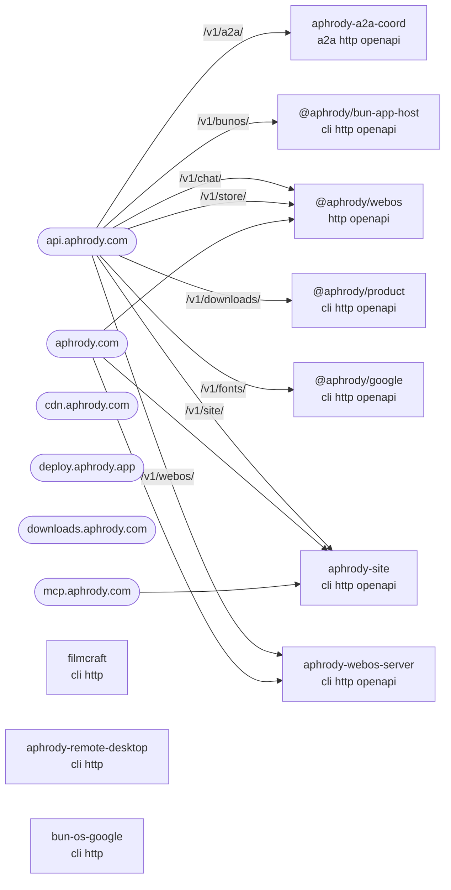

# Services and APIs

Generated by `bun scripts/service-map.ts` from the source tree, `infra/config/host` units, nginx sites and
`infra/fleet/api.toml`; do not edit by hand. Machine-readable form:
[`docs/generated/services.json`](../generated/services.json); API catalogue:
[`docs/generated/openapi/`](../generated/openapi/index.json), served at https://api.aphrody.com/v1/.

Totals over 757 members: 81 http, 17 mcp, 7 a2a, 165 cli, 10 openapi, 16 wasm.
Every service routed by the gateway publishes an OpenAPI 3.1 document, answers `/health` in the standard shape and
returns problem+json errors ([API.md](API.md)); `bun scripts/service-map.ts --check` fails otherwise.

## API catalogue

| Service   | Base                                    | OpenAPI                                    | Operations | Source                        | Unit                          |
| --------- | --------------------------------------- | ------------------------------------------ | ---------- | ----------------------------- | ----------------------------- |
| a2a       | `https://api.aphrody.com/v1/a2a/`       | [cargo](../generated/openapi/a2a.json)     | 26         | `crates/aphrody-a2a-coord`    | aphrody-a2a.service           |
| bunos     | `https://api.aphrody.com/v1/bunos/`     | [bun](../generated/openapi/bunos.json)     | 6          | `packages/bun-app-host`       | aphrody-bun-os-server.service |
| chat      | `https://api.aphrody.com/v1/chat/`      | [bun](../generated/openapi/chat.json)      | 5          | `apps/webos`                  | aphrody-chat-gateway.service  |
| downloads | `https://api.aphrody.com/v1/downloads/` | [bun](../generated/openapi/downloads.json) | 11         | `packages/product`            | aphrody-downloads.service     |
| fonts     | `https://api.aphrody.com/v1/fonts/`     | [bun](../generated/openapi/fonts.json)     | 7          | `packages/google`             | aphrody-fonts-proxy.service   |
| site      | `https://api.aphrody.com/v1/site/`      | [cargo](../generated/openapi/site.json)    | 17         | `crates/aphrody-site`         | aphrody-site.service          |
| store     | `https://api.aphrody.com/v1/store/`     | [bun](../generated/openapi/store.json)     | 8          | `apps/webos`                  | aphrody-store.service         |
| webos     | `https://api.aphrody.com/v1/webos/`     | [cargo](../generated/openapi/webos.json)   | 15         | `crates/aphrody-webos-server` | aphrody-webos.service         |

The merged document of every service is [`openapi.json`](../generated/openapi/openapi.json)
(https://api.aphrody.com/v1/openapi.json).

## HTTP members by role

| Role     | Members | Meaning                                                                                            |
| -------- | ------- | -------------------------------------------------------------------------------------------------- |
| gateway  | 7       | public through the API gateway; OpenAPI document, `/health` and problem+json errors required       |
| deployed | 3       | run by a host unit outside the gateway (internal, loopback or host-local)                          |
| server   | 31      | a binary that binds a listener but is not deployed (desktop apps, local tools, standalone servers) |
| library  | 33      | a router or listener embedded by another server (merged into its document when routed)             |
| dev      | 5       | development, demo or test servers only                                                             |
| client   | 2       | uses an HTTP framework or client without binding a listener                                        |

- **deployed**: `apps/filmcraft`, `crates/aphrody-remote-desktop`, `crates/bun-os-google`
- **server**: `apps/artcraft`, `apps/designcraft`, `apps/effectcraft`, `apps/lightcraft`, `apps/vectorcraft`, `apps/wordcraft`, `cloud/aphrody-accounts`, `crates/aphrody-accounts`, `crates/aphrody-infra`, `crates/aphrody-llama-server`, `crates/aphrody-nie-cli`, `crates/aphrody-nie-model-serve`, `crates/bunos-wsl`, `crates/effectcraft-xtask`, `crates/filmcraft-xtask`, `crates/lightcraft-xtask`, `packages/arch-index`, `packages/bun-engine`, `packages/bun-gamestream`, `packages/bun-os-platform`, `packages/bun-steam`, `packages/bun-tauri`, `packages/bunos-init`, `packages/fluent`, `packages/m3`, `packages/m3-bun`, `packages/m3-design`, `packages/m3-next-migrate`, `packages/themes`, `packages/yolo-cli`, `packages/yolo-core`
- **library**: `crates/aphrody-a2a-client`, `crates/aphrody-a2a-server`, `crates/aphrody-agent-tools`, `crates/aphrody-antigravity`, `crates/aphrody-app-server`, `crates/aphrody-command`, `crates/aphrody-embed`, `crates/aphrody-gateway`, `crates/aphrody-gemini-runtime`, `crates/aphrody-http-error`, `crates/aphrody-inventory`, `crates/aphrody-jev`, `crates/aphrody-kernel`, `crates/aphrody-mcp`, `crates/aphrody-model-client`, `crates/aphrody-models`, `crates/aphrody-nie-formats`, `crates/aphrody-rag`, `crates/aphrody-terminal-backend`, `crates/bun-os-pkg`, `crates/bun-ui-web`, `crates/fal_client`, `crates/lightcraft-engine`, `crates/lightcraft-fetch`, `crates/lu-native`, `crates/ruzu-core`, `crates/ruzu-web-service`, `crates/tauri-plugin-aphrody`, `crates/tauri-plugin-mcp-bridge`, `crates/vectorcraft-mcp`, `crates/wordcraft-zotero`, `crates/yolo-runtime`, `packages/bun-windows-winclean`
- **dev**: `packages/android-web`, `packages/artcraft-frontend`, `packages/gemma-web`, `packages/identity`, `packages/menu-render`
- **client**: `crates/aphrody-memory`, `crates/aphrody-webos-sessions`

## Public routing

## Service matrix

| Member                            | Lang  | Role     | Exposes            | Binaries                                                  | Deployed ports | Units                           | Public hosts                 | Routes (sample)                                                                                                                                      |
| --------------------------------- | ----- | -------- | ------------------ | --------------------------------------------------------- | -------------- | ------------------------------- | ---------------------------- | ---------------------------------------------------------------------------------------------------------------------------------------------------- |
| `apps/artcraft`                   | rust  | server   | http               | artcraft                                                  |                |                                 |                              |                                                                                                                                                      |
| `apps/designcraft`                | rust  | server   | http               | designcraft                                               |                |                                 |                              |                                                                                                                                                      |
| `apps/effectcraft`                | rust  | server   | http               | effectcraft                                               |                |                                 |                              |                                                                                                                                                      |
| `apps/filmcraft`                  | rust  | deployed | http               | filmcraft                                                 | 8765           | aphrody-video-editor.service    |                              |                                                                                                                                                      |
| `apps/lightcraft`                 | rust  | server   | http               | lightcraft                                                |                |                                 |                              |                                                                                                                                                      |
| `apps/vectorcraft`                | rust  | server   | http               | vectorcraft                                               |                |                                 |                              |                                                                                                                                                      |
| `apps/webos`                      | bun   | gateway  | http, openapi      |                                                           | 8790, 8799     | aphrody-webos.service           | aphrody.com                  |                                                                                                                                                      |
| `apps/wordcraft`                  | rust  | server   | http               | wordcraft                                                 |                |                                 |                              |                                                                                                                                                      |
| `cloud/aphrody-accounts`          | rust  | server   | http               | aphrody-accounts                                          |                |                                 |                              |                                                                                                                                                      |
| `crates/aphrody-a2a`              | rust  |          | a2a                |                                                           |                |                                 |                              |                                                                                                                                                      |
| `crates/aphrody-a2a-client`       | rust  | library  | a2a, http          |                                                           |                |                                 |                              |                                                                                                                                                      |
| `crates/aphrody-a2a-coord`        | rust  | gateway  | a2a, http, openapi |                                                           |                |                                 |                              | `/coord` `/coord/{namespace}/envelopes` `/coord/{namespace}/tasks` `/coord/{namespace}/tasks/{task_id}` `/health` `/msg`                             |
| `crates/aphrody-a2a-grpc`         | rust  |          | a2a                |                                                           |                |                                 |                              |                                                                                                                                                      |
| `crates/aphrody-a2a-pb`           | rust  |          | a2a                |                                                           |                |                                 |                              |                                                                                                                                                      |
| `crates/aphrody-a2a-server`       | rust  | library  | a2a, http          |                                                           |                |                                 |                              | `/` `/executeCommand` `/listCommands` `/tasks` `/tasks/metadata` `/tasks/{id}`                                                                       |
| `crates/aphrody-accounts`         | rust  | server   | http               | aphrody-accounts                                          |                |                                 |                              |                                                                                                                                                      |
| `crates/aphrody-agent-tools`      | rust  | library  | http               |                                                           |                |                                 |                              | `/v1/systemone`                                                                                                                                      |
| `crates/aphrody-antigravity`      | rust  | library  | http               |                                                           |                |                                 |                              |                                                                                                                                                      |
| `crates/aphrody-app-server`       | rust  | library  | http               |                                                           |                |                                 |                              | `/` `/app.css` `/app.js` `/events` `/health` `/healthz`                                                                                              |
| `crates/aphrody-command`          | rust  | library  | http               |                                                           |                |                                 |                              |                                                                                                                                                      |
| `crates/aphrody-embed`            | rust  | library  | http               |                                                           |                |                                 |                              | `/health` `/v1/embeddings`                                                                                                                           |
| `crates/aphrody-gateway`          | rust  | library  | http               |                                                           |                |                                 |                              | `/health` `/healthz` `/v1/chat/completions` `/v1/models`                                                                                             |
| `crates/aphrody-gemini-runtime`   | rust  | library  | http               |                                                           |                |                                 |                              |                                                                                                                                                      |
| `crates/aphrody-http-error`       | rust  | library  | http               |                                                           |                |                                 |                              |                                                                                                                                                      |
| `crates/aphrody-infra`            | rust  | server   | http               | bunos-infra                                               |                |                                 |                              |                                                                                                                                                      |
| `crates/aphrody-inventory`        | rust  | library  | http               | aphrody-inventory                                         |                |                                 |                              | `/api/inventory` `/api/inventory/{*rest}` `/api/rpc` `/wasm/modules/{*rest}`                                                                         |
| `crates/aphrody-jev`              | rust  | library  | http               |                                                           |                |                                 |                              | `/healthz` `/v1/models` `/v1/systemone`                                                                                                              |
| `crates/aphrody-kernel`           | rust  | library  | http               |                                                           |                |                                 |                              |                                                                                                                                                      |
| `crates/aphrody-llama-server`     | rust  | server   | http               | aphrody-fake-llama-server, aphrody-llama-daemon           |                |                                 |                              | `/health` `/v1/chat/completions` `/v1/models` `/v1/responses` `/v1/responses/compact`                                                                |
| `crates/aphrody-mcp`              | rust  | library  | http, mcp          |                                                           |                |                                 |                              | `/api/v1/aphrody/status` `/api/v1/models` `/api/v1/rag/query` `/api/v1/rag/search` `/api/v1/rag/stats` `/api/v1/web/search`                          |
| `crates/aphrody-mcp-client`       | rust  |          | mcp                |                                                           |                |                                 |                              |                                                                                                                                                      |
| `crates/aphrody-memory`           | rust  | client   | http               |                                                           |                |                                 |                              |                                                                                                                                                      |
| `crates/aphrody-model-client`     | rust  | library  | http               |                                                           |                |                                 |                              | `/api/chat` `/api/delete` `/api/embed` `/api/generate` `/api/ps` `/api/pull`                                                                         |
| `crates/aphrody-models`           | rust  | library  | http               |                                                           |                |                                 |                              |                                                                                                                                                      |
| `crates/aphrody-nie-cli`          | rust  | server   | http, mcp          | nie                                                       |                |                                 |                              |                                                                                                                                                      |
| `crates/aphrody-nie-formats`      | rust  | library  | http               |                                                           |                |                                 |                              |                                                                                                                                                      |
| `crates/aphrody-nie-mcp`          | rust  |          | mcp                | aphrody-nie-mcp                                           |                |                                 |                              |                                                                                                                                                      |
| `crates/aphrody-nie-model-serve`  | rust  | server   | http               | aphrody-nie-model-serve                                   |                |                                 |                              |                                                                                                                                                      |
| `crates/aphrody-rag`              | rust  | library  | http               |                                                           |                |                                 |                              |                                                                                                                                                      |
| `crates/aphrody-remote-desktop`   | rust  | deployed | http               | aphrody-remote-desktop                                    | 5555, 8799     | aphrody-android-gateway.service |                              | `/` `/api/android/` `/api/android/health` `/api/android/stream` `/healthz` `/ws`                                                                     |
| `crates/aphrody-site`             | rust  | gateway  | http, openapi      | aphrody-site                                              | 8083           | aphrody-site.service            | aphrody.com, mcp.aphrody.com | `/api/design` `/api/design/assets` `/api/design/docs` `/api/design/docs/{*slug}` `/api/design/google` `/api/design/google/docs/{*slug}`              |
| `crates/aphrody-terminal-backend` | rust  | library  | http               |                                                           |                |                                 |                              |                                                                                                                                                      |
| `crates/aphrody-webos-server`     | rust  | gateway  | http, openapi      | aphrody-webos                                             | 8790, 8799     | aphrody-webos.service           | aphrody.com                  | `/` `/api/emulators` `/api/emulators/qualification` `/api/emulators/qualification/{file}` `/api/health` `/api/session`                               |
| `crates/aphrody-webos-sessions`   | rust  | client   | http               |                                                           |                |                                 |                              |                                                                                                                                                      |
| `crates/bun-os-google`            | rust  | deployed | http               | bun-os-google                                             | 8802           | aphrody-google.service          |                              | `/api/google/calendar/list` `/api/google/callback` `/api/google/drive/root` `/api/google/gcs/buckets` `/api/google/gmail/labels` `/api/google/login` |
| `crates/bun-os-pkg`               | rust  | library  | http               |                                                           |                |                                 |                              |                                                                                                                                                      |
| `crates/bun-ui-web`               | rust  | library  | http, wasm         |                                                           |                |                                 |                              | `/ui` `/ui/` `/ui/apps.json` `/ui/host/{*rest}` `/ui/{toolkit}/{id}` `/ui/{toolkit}/{id}/`                                                           |
| `crates/bunos-wsl`                | rust  | server   | http               | bunos-wsl-cli                                             |                |                                 |                              |                                                                                                                                                      |
| `crates/cadcraft-mcp`             | rust  |          | mcp                |                                                           |                |                                 |                              |                                                                                                                                                      |
| `crates/deckcraft-mcp`            | rust  |          | mcp                |                                                           |                |                                 |                              |                                                                                                                                                      |
| `crates/designcraft-mcp`          | rust  |          | mcp                |                                                           |                |                                 |                              |                                                                                                                                                      |
| `crates/effectcraft-xtask`        | rust  | server   | http               | effectcraft-xtask                                         |                |                                 |                              |                                                                                                                                                      |
| `crates/fal_client`               | rust  | library  | http               |                                                           |                |                                 |                              |                                                                                                                                                      |
| `crates/figcraft-mcp`             | rust  |          | mcp                |                                                           |                |                                 |                              |                                                                                                                                                      |
| `crates/filmcraft-automation`     | rust  |          | mcp                |                                                           |                |                                 |                              |                                                                                                                                                      |
| `crates/filmcraft-xtask`          | rust  | server   | http               | filmcraft-xtask                                           |                |                                 |                              |                                                                                                                                                      |
| `crates/gridcraft-mcp`            | rust  |          | mcp                |                                                           |                |                                 |                              |                                                                                                                                                      |
| `crates/lightcraft-engine`        | rust  | library  | http               |                                                           |                |                                 |                              |                                                                                                                                                      |
| `crates/lightcraft-fetch`         | rust  | library  | http               |                                                           |                |                                 |                              |                                                                                                                                                      |
| `crates/lightcraft-mcp`           | rust  |          | mcp                |                                                           |                |                                 |                              |                                                                                                                                                      |
| `crates/lightcraft-xtask`         | rust  | server   | http               | lightcraft-xtask                                          |                |                                 |                              |                                                                                                                                                      |
| `crates/lu-native`                | rust  | library  | http               |                                                           |                |                                 |                              |                                                                                                                                                      |
| `crates/photocraft-automation`    | rust  |          | mcp                |                                                           |                |                                 |                              |                                                                                                                                                      |
| `crates/ruzu-core`                | rust  | library  | http               |                                                           |                |                                 |                              |                                                                                                                                                      |
| `crates/ruzu-web-service`         | rust  | library  | http               |                                                           |                |                                 |                              |                                                                                                                                                      |
| `crates/tauri-plugin-aphrody`     | rust  | library  | http               |                                                           |                |                                 |                              |                                                                                                                                                      |
| `crates/tauri-plugin-mcp-bridge`  | rust  | library  | http, mcp          |                                                           |                |                                 |                              |                                                                                                                                                      |
| `crates/vectorcraft-mcp`          | rust  | library  | http, mcp          |                                                           |                |                                 |                              |                                                                                                                                                      |
| `crates/wordcraft-mcp`            | rust  |          | mcp                |                                                           |                |                                 |                              |                                                                                                                                                      |
| `crates/wordcraft-zotero`         | rust  | library  | http               |                                                           |                |                                 |                              |                                                                                                                                                      |
| `crates/yolo-runtime`             | rust  | library  | http               |                                                           |                |                                 |                              |                                                                                                                                                      |
| `packages/a2a`                    | bun   |          | a2a                |                                                           |                |                                 |                              |                                                                                                                                                      |
| `packages/android-web`            | bun   | dev      | http               |                                                           |                |                                 |                              |                                                                                                                                                      |
| `packages/arch-index`             | bun   | server   | http               | bunos-arch                                                |                |                                 |                              |                                                                                                                                                      |
| `packages/artcraft-frontend`      | bun   | dev      | http               |                                                           |                |                                 |                              | `/v1/logout` `/v1/media_files/list/user/session_smoke` `/v1/session`                                                                                 |
| `packages/bun-app-host`           | bun   | gateway  | http, openapi      | aphrody-server                                            |                |                                 |                              | `/api/catalog` `/api/help` `/api/v1/apps` `/api/v1/owners` `/api/v1/sources` `/api/v1/status`                                                        |
| `packages/bun-arch-mcp`           | bun   |          | mcp                | bun-arch-docs, bun-arch-mcp                               |                |                                 |                              |                                                                                                                                                      |
| `packages/bun-engine`             | bun   | server   | http               | bep, bun-engine, bun-engine-formats                       |                |                                 |                              | `/api/emulation` `/api/emulators` `/health`                                                                                                          |
| `packages/bun-gamestream`         | bun   | server   | http               |                                                           |                |                                 |                              |                                                                                                                                                      |
| `packages/bun-os-platform`        | bun   | server   | http               | bun-os-platform                                           |                |                                 |                              |                                                                                                                                                      |
| `packages/bun-steam`              | bun   | server   | http               | bun-steam                                                 |                |                                 |                              |                                                                                                                                                      |
| `packages/bun-tauri`              | mixed | server   | http               | bun-tauri-sidecar                                         |                |                                 |                              |                                                                                                                                                      |
| `packages/bun-windows-winclean`   | rust  | library  | http               |                                                           |                |                                 |                              |                                                                                                                                                      |
| `packages/bunos-init`             | bun   | server   | http               | bunos-init                                                |                |                                 |                              | `/health`                                                                                                                                            |
| `packages/fluent`                 | bun   | server   | http               |                                                           |                |                                 |                              |                                                                                                                                                      |
| `packages/gemma-web`              | bun   | dev      | http               |                                                           |                |                                 |                              |                                                                                                                                                      |
| `packages/google`                 | bun   | gateway  | http, openapi      | bun-google, bun-google-index-public                       |                |                                 |                              |                                                                                                                                                      |
| `packages/identity`               | bun   | dev      | http               |                                                           |                |                                 |                              |                                                                                                                                                      |
| `packages/m3`                     | bun   | server   | http               | m3                                                        |                |                                 |                              |                                                                                                                                                      |
| `packages/m3-bun`                 | bun   | server   | http               | m3-bun                                                    |                |                                 |                              | `/api/m3/info` `/healthz`                                                                                                                            |
| `packages/m3-design`              | bun   | server   | http               | m3-design                                                 |                |                                 |                              | `/api/generate` `/api/generate/finalize`                                                                                                             |
| `packages/m3-mcp`                 | bun   |          | mcp                |                                                           |                |                                 |                              |                                                                                                                                                      |
| `packages/m3-next-migrate`        | bun   | server   | http               | m3-next-migrate, next-migrate                             |                |                                 |                              |                                                                                                                                                      |
| `packages/menu-render`            | bun   | dev      | http               |                                                           |                |                                 |                              | `/api/layout`                                                                                                                                        |
| `packages/product`                | bun   | gateway  | http, openapi      | aphrody-omar, aphrody-product, aphrody-setup, creator-kit |                |                                 |                              | `/api/docs` `/api/index/search` `/api/search` `/health` `/healthz`                                                                                   |
| `packages/themes`                 | bun   | server   | http               |                                                           |                |                                 |                              |                                                                                                                                                      |
| `packages/yolo-cli`               | bun   | server   | http               | yolo                                                      |                |                                 |                              |                                                                                                                                                      |
| `packages/yolo-core`              | bun   | server   | http               |                                                           |                |                                 |                              |                                                                                                                                                      |

## Command-line tools

| Member                               | Lang  | Binaries                                                                                                                                                                                                                                                                                                                                                                                             |
| ------------------------------------ | ----- | ---------------------------------------------------------------------------------------------------------------------------------------------------------------------------------------------------------------------------------------------------------------------------------------------------------------------------------------------------------------------------------------------------- |
| `apps/aphrody-model-view`            | mixed | aphrody-model-view                                                                                                                                                                                                                                                                                                                                                                                   |
| `apps/artcraft_native`               | rust  | artcraft-native                                                                                                                                                                                                                                                                                                                                                                                      |
| `apps/cadcraft-web`                  | rust  | cadcraft-web                                                                                                                                                                                                                                                                                                                                                                                         |
| `apps/deckcraft`                     | rust  | deckcraft                                                                                                                                                                                                                                                                                                                                                                                            |
| `apps/deckcraft-cli`                 | rust  | deckcraft-cli                                                                                                                                                                                                                                                                                                                                                                                        |
| `apps/deckcraft-web`                 | rust  | deckcraft-web                                                                                                                                                                                                                                                                                                                                                                                        |
| `apps/designcraft-cli`               | rust  | designcraft-cli                                                                                                                                                                                                                                                                                                                                                                                      |
| `apps/designcraft-web`               | rust  | designcraft-web                                                                                                                                                                                                                                                                                                                                                                                      |
| `apps/effectcraft-cli`               | rust  | effectcraft-cli                                                                                                                                                                                                                                                                                                                                                                                      |
| `apps/figcraft`                      | rust  | figcraft                                                                                                                                                                                                                                                                                                                                                                                             |
| `apps/figcraft-cli`                  | rust  | figcraft-cli                                                                                                                                                                                                                                                                                                                                                                                         |
| `apps/figcraft-server`               | rust  | figcraft-server                                                                                                                                                                                                                                                                                                                                                                                      |
| `apps/figcraft-web`                  | rust  | figcraft-web                                                                                                                                                                                                                                                                                                                                                                                         |
| `apps/filmcraft-cli`                 | rust  | filmcraft-cli                                                                                                                                                                                                                                                                                                                                                                                        |
| `apps/gridcraft`                     | rust  | gridcraft                                                                                                                                                                                                                                                                                                                                                                                            |
| `apps/gridcraft-cli`                 | rust  | gridcraft-cli                                                                                                                                                                                                                                                                                                                                                                                        |
| `apps/gridcraft-web`                 | rust  | gridcraft-web                                                                                                                                                                                                                                                                                                                                                                                        |
| `apps/lightcraft-cli`                | rust  | lightcraft-cli                                                                                                                                                                                                                                                                                                                                                                                       |
| `apps/m3-published-consumer`         | rust  | material-published-consumer                                                                                                                                                                                                                                                                                                                                                                          |
| `apps/pdfcraft`                      | rust  | pdfcraft                                                                                                                                                                                                                                                                                                                                                                                             |
| `apps/pdfcraft-cli`                  | rust  | pdfcraft-cli                                                                                                                                                                                                                                                                                                                                                                                         |
| `apps/pdfcraft-web`                  | rust  | pdfcraft-web                                                                                                                                                                                                                                                                                                                                                                                         |
| `apps/photocraft`                    | rust  | photocraft                                                                                                                                                                                                                                                                                                                                                                                           |
| `apps/photocraft-cli`                | rust  | photocraft-cli                                                                                                                                                                                                                                                                                                                                                                                       |
| `apps/photocraft-web`                | rust  | photocraft-web                                                                                                                                                                                                                                                                                                                                                                                       |
| `apps/soundcraft`                    | rust  | soundcraft                                                                                                                                                                                                                                                                                                                                                                                           |
| `apps/soundcraft-cli`                | rust  | soundcraft-cli                                                                                                                                                                                                                                                                                                                                                                                       |
| `apps/soundcraft-web`                | rust  | soundcraft-web                                                                                                                                                                                                                                                                                                                                                                                       |
| `apps/vectorcraft-cli`               | rust  | vectorcraft-cli                                                                                                                                                                                                                                                                                                                                                                                      |
| `apps/vectorcraft-web`               | rust  | vectorcraft-web                                                                                                                                                                                                                                                                                                                                                                                      |
| `apps/wordcraft-cli`                 | rust  | wordcraft-cli                                                                                                                                                                                                                                                                                                                                                                                        |
| `apps/wordcraft-web`                 | rust  | wordcraft-web                                                                                                                                                                                                                                                                                                                                                                                        |
| `crates/android-native`              | rust  | uniffi-bindgen                                                                                                                                                                                                                                                                                                                                                                                       |
| `crates/aphrody`                     | rust  | aphrody                                                                                                                                                                                                                                                                                                                                                                                              |
| `crates/aphrody-certificates`        | rust  | aphrody-certificates                                                                                                                                                                                                                                                                                                                                                                                 |
| `crates/aphrody-chat`                | rust  | aphrody-chat                                                                                                                                                                                                                                                                                                                                                                                         |
| `crates/aphrody-code-graph`          | rust  | aphrody-graph                                                                                                                                                                                                                                                                                                                                                                                        |
| `crates/aphrody-ctr-desktop`         | rust  | aphrody-ctr                                                                                                                                                                                                                                                                                                                                                                                          |
| `crates/aphrody-dust-cli`            | rust  | dust                                                                                                                                                                                                                                                                                                                                                                                                 |
| `crates/aphrody-homebrew`            | rust  | aphrody-homebrew                                                                                                                                                                                                                                                                                                                                                                                     |
| `crates/aphrody-nds-sdk`             | rust  | nds-sdk                                                                                                                                                                                                                                                                                                                                                                                              |
| `crates/aphrody-nie-bench`           | rust  | aphrody-nie-bench                                                                                                                                                                                                                                                                                                                                                                                    |
| `crates/aphrody-nie-camera`          | rust  | nie-cam                                                                                                                                                                                                                                                                                                                                                                                              |
| `crates/aphrody-nie-data`            | rust  | export_formations, export_passives, export_skills                                                                                                                                                                                                                                                                                                                                                    |
| `crates/aphrody-nie-editor`          | rust  | aphrody-nie-editor                                                                                                                                                                                                                                                                                                                                                                                   |
| `crates/aphrody-nie-forge`           | rust  | aphrody-nie-forge                                                                                                                                                                                                                                                                                                                                                                                    |
| `crates/aphrody-nie-game`            | rust  | aphrody-nie-game                                                                                                                                                                                                                                                                                                                                                                                     |
| `crates/aphrody-nie-headless`        | rust  | aphrody-nie-headless                                                                                                                                                                                                                                                                                                                                                                                 |
| `crates/aphrody-nie-identity-source` | rust  | export_aphrody                                                                                                                                                                                                                                                                                                                                                                                       |
| `crates/aphrody-nie-inventory`       | rust  | ievr-tools                                                                                                                                                                                                                                                                                                                                                                                           |
| `crates/aphrody-nie-launcher`        | rust  | aphrody-nie-launcher                                                                                                                                                                                                                                                                                                                                                                                 |
| `crates/aphrody-nie-ocgen`           | rust  | aphrody-nie-ocgen                                                                                                                                                                                                                                                                                                                                                                                    |
| `crates/aphrody-nie-pg`              | rust  | aphrody-nie-pg                                                                                                                                                                                                                                                                                                                                                                                       |
| `crates/aphrody-nie-play`            | rust  | aphrody-nie-play                                                                                                                                                                                                                                                                                                                                                                                     |
| `crates/aphrody-nie-render3d`        | rust  | aphrody-nie-render3d                                                                                                                                                                                                                                                                                                                                                                                 |
| `crates/aphrody-nie-runtime`         | rust  | aphrody-nie-runtime, nie-match3d                                                                                                                                                                                                                                                                                                                                                                     |
| `crates/aphrody-nie-trace`           | rust  | nie-edit, nie-mem                                                                                                                                                                                                                                                                                                                                                                                    |
| `crates/aphrody-nie-ui`              | rust  | game_screens_css                                                                                                                                                                                                                                                                                                                                                                                     |
| `crates/aphrody-nie-zukan`           | rust  | aphrody-nie-zukan                                                                                                                                                                                                                                                                                                                                                                                    |
| `crates/aphrody-search`              | rust  | aphrody-search                                                                                                                                                                                                                                                                                                                                                                                       |
| `crates/aphrody-store`               | rust  | aphrody-store                                                                                                                                                                                                                                                                                                                                                                                        |
| `crates/aphrody-wasm-host`           | rust  | aphrody-wasm-host                                                                                                                                                                                                                                                                                                                                                                                    |
| `crates/aphrody-wasm-wasi-hello`     | rust  | aphrody-wasm-wasi-hello                                                                                                                                                                                                                                                                                                                                                                              |
| `crates/apkeep`                      | rust  | apkeep                                                                                                                                                                                                                                                                                                                                                                                               |
| `crates/artcraft_router`             | rust  | artcraft-cli                                                                                                                                                                                                                                                                                                                                                                                         |
| `crates/bun-engine-core`             | rust  | bun-engine                                                                                                                                                                                                                                                                                                                                                                                           |
| `crates/bun-os-env-cookie`           | rust  | bun-os-cookie, bun-os-env                                                                                                                                                                                                                                                                                                                                                                            |
| `crates/bun-os-host`                 | rust  | bun-os-host                                                                                                                                                                                                                                                                                                                                                                                          |
| `crates/bun-os-platform`             | rust  | bun-os-platform-native                                                                                                                                                                                                                                                                                                                                                                               |
| `crates/bun-os-shell`                | rust  | bun-os-shell                                                                                                                                                                                                                                                                                                                                                                                         |
| `crates/bun-steam`                   | rust  | bun-steam-depot                                                                                                                                                                                                                                                                                                                                                                                      |
| `crates/bun-waydroid`                | rust  | bun-waydroid                                                                                                                                                                                                                                                                                                                                                                                         |
| `crates/bunos-bridge`                | rust  | bunos-run                                                                                                                                                                                                                                                                                                                                                                                            |
| `crates/bunos-design`                | rust  | bunos-design                                                                                                                                                                                                                                                                                                                                                                                         |
| `crates/bunos-nt-bridge`             | rust  | bunos-winbridge                                                                                                                                                                                                                                                                                                                                                                                      |
| `crates/bunos-nt-client`             | rust  | bunos-nt                                                                                                                                                                                                                                                                                                                                                                                             |
| `crates/bunos-utils`                 | rust  | bunos-utils                                                                                                                                                                                                                                                                                                                                                                                          |
| `crates/bunos-wayland-win`           | rust  | bunos-wayland-win, bunos-wlhost                                                                                                                                                                                                                                                                                                                                                                      |
| `crates/bunos-win11`                 | rust  | bunos-win11                                                                                                                                                                                                                                                                                                                                                                                          |
| `crates/bunos-win11-chrome`          | rust  | bunos-win11-chrome                                                                                                                                                                                                                                                                                                                                                                                   |
| `crates/bunos-win11-wallpaper`       | rust  | bunos-win11-wallpaper                                                                                                                                                                                                                                                                                                                                                                                |
| `crates/bunos-wsl-service`           | rust  | bunos-wsl-service                                                                                                                                                                                                                                                                                                                                                                                    |
| `crates/cadcraft`                    | rust  | cadcraft                                                                                                                                                                                                                                                                                                                                                                                             |
| `crates/cadcraft-cli`                | rust  | cadcraft-cli                                                                                                                                                                                                                                                                                                                                                                                         |
| `crates/cadcraft-xtask`              | rust  | cadcraft-xtask                                                                                                                                                                                                                                                                                                                                                                                       |
| `crates/capture_harness`             | rust  | capture-harness                                                                                                                                                                                                                                                                                                                                                                                      |
| `crates/deckcraft-xtask`             | rust  | deckcraft-xtask                                                                                                                                                                                                                                                                                                                                                                                      |
| `crates/designcraft-xtask`           | rust  | designcraft-xtask                                                                                                                                                                                                                                                                                                                                                                                    |
| `crates/figcraft-xtask`              | rust  | figcraft-xtask                                                                                                                                                                                                                                                                                                                                                                                       |
| `crates/gridcraft-xtask`             | rust  | gridcraft-xtask                                                                                                                                                                                                                                                                                                                                                                                      |
| `crates/media-core`                  | rust  | media-core                                                                                                                                                                                                                                                                                                                                                                                           |
| `crates/nu_plugin_windows`           | rust  | nu_plugin_windows, win                                                                                                                                                                                                                                                                                                                                                                               |
| `crates/pdfcraft-xtask`              | rust  | pdfcraft-xtask                                                                                                                                                                                                                                                                                                                                                                                       |
| `crates/photocraft-xtask`            | rust  | photocraft-xtask                                                                                                                                                                                                                                                                                                                                                                                     |
| `crates/rdynarmic`                   | rust  | a32_diff, compile_bench                                                                                                                                                                                                                                                                                                                                                                              |
| `crates/re`                          | rust  | bunre                                                                                                                                                                                                                                                                                                                                                                                                |
| `crates/ruzu`                        | rust  | ruzu                                                                                                                                                                                                                                                                                                                                                                                                 |
| `crates/ruzu-cmd`                    | rust  | ruzu-cmd                                                                                                                                                                                                                                                                                                                                                                                             |
| `crates/ruzu-dedicated-room`         | rust  | dedicated-room                                                                                                                                                                                                                                                                                                                                                                                       |
| `crates/soundcraft-xtask`            | rust  | soundcraft-xtask                                                                                                                                                                                                                                                                                                                                                                                     |
| `crates/vectorcraft-xtask`           | rust  | vectorcraft-xtask                                                                                                                                                                                                                                                                                                                                                                                    |
| `crates/wordcraft-xtask`             | rust  | wordcraft-xtask                                                                                                                                                                                                                                                                                                                                                                                      |
| `packages/aphrody-web`               | bun   | aphrody-web                                                                                                                                                                                                                                                                                                                                                                                          |
| `packages/bun-android`               | bun   | bun-android                                                                                                                                                                                                                                                                                                                                                                                          |
| `packages/bun-artifacts`             | bun   | aphrody-artifacts                                                                                                                                                                                                                                                                                                                                                                                    |
| `packages/bun-blender`               | bun   | bun-blender, bun-blender-mcp                                                                                                                                                                                                                                                                                                                                                                         |
| `packages/bun-emu-host`              | bun   | bun-emu-host                                                                                                                                                                                                                                                                                                                                                                                         |
| `packages/bun-os-plugins`            | bun   | bun-os-plugins, bunos-agent-plugin, bunos-bench, bunos-cookie, bunos-crawl, bunos-docker, bunos-docs, bunos-dotnet, bunos-env, bunos-host, bunos-just, bunos-lsp, bunos-mcp, bunos-migrate, bunos-msvc, bunos-n2b, bunos-parse, bunos-plugin, bunos-pwsh, bunos-python, bunos-rename, bunos-search, bunos-sh, bunos-ssh, bunos-uv, bunos-vpn, bunos-wasm, bunos-winget, bunos-winmd, bunos-workspace |
| `packages/bun-video-project`         | bun   | aphrody-video                                                                                                                                                                                                                                                                                                                                                                                        |
| `packages/bun-workspace`             | bun   | aphrody-bun                                                                                                                                                                                                                                                                                                                                                                                          |
| `packages/buncc`                     | bun   | buncc                                                                                                                                                                                                                                                                                                                                                                                                |
| `packages/bunos-run`                 | bun   | bunos                                                                                                                                                                                                                                                                                                                                                                                                |
| `packages/chromium`                  | bun   | bun-chromium                                                                                                                                                                                                                                                                                                                                                                                         |
| `packages/ds-dotnet`                 | bun   | ds-dotnet                                                                                                                                                                                                                                                                                                                                                                                            |
| `packages/iecode-homebrew`           | bun   | iecode-homebrew                                                                                                                                                                                                                                                                                                                                                                                      |
| `packages/inagle`                    | bun   | inagle                                                                                                                                                                                                                                                                                                                                                                                               |
| `packages/m3-next`                   | bun   | m3-next                                                                                                                                                                                                                                                                                                                                                                                              |
| `packages/m3-os-themes`              | bun   | m3-os-themes                                                                                                                                                                                                                                                                                                                                                                                         |
| `packages/material-design-icons`     | bun   | m3-svg-to-ico                                                                                                                                                                                                                                                                                                                                                                                        |
| `packages/package-converter`         | bun   | package-converter, pacman2apt                                                                                                                                                                                                                                                                                                                                                                        |
| `packages/re`                        | bun   | re                                                                                                                                                                                                                                                                                                                                                                                                   |
| `packages/scaffold`                  | bun   | aphrody-scaffold                                                                                                                                                                                                                                                                                                                                                                                     |
| `packages/tauri-themes-bridge`       | bun   | aphrody-theme-stage                                                                                                                                                                                                                                                                                                                                                                                  |
| `packages/wasm`                      | bun   | aphrody-wasm                                                                                                                                                                                                                                                                                                                                                                                         |
| `packages/wasmos`                    | bun   | wasmos                                                                                                                                                                                                                                                                                                                                                                                               |
| `packages/waydroid`                  | bun   | bun-waydroid-gateway                                                                                                                                                                                                                                                                                                                                                                                 |
| `packages/web-to-tauri`              | bun   | web-to-tauri                                                                                                                                                                                                                                                                                                                                                                                         |
