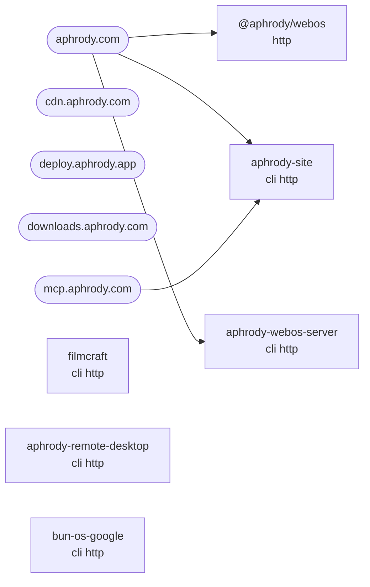

# Services and APIs

Generated by `bun scripts/service-map.ts` from the source tree, `infra/config/host` units and nginx sites; do not
edit by hand. Machine-readable form: [`docs/generated/services.json`](../generated/services.json).

Totals over 741 members: 79 http, 17 mcp, 7 a2a, 152 cli, 3 openapi, 16 wasm.
An HTTP service without `openapi` has no published contract yet (target: every public API ships an OpenAPI 3.1
document, see [API.md](API.md)).

## Public routing

## Service matrix

| Member | Lang | Exposes | Binaries | Deployed ports | Units | Public hosts | Routes (sample) |
| ------ | ---- | ------- | -------- | ----- | ----- | ------------ | --------------- |
| `apps/artcraft` | rust | http | artcraft |  |  |  |  |
| `apps/designcraft` | rust | http | designcraft |  |  |  |  |
| `apps/effectcraft` | rust | http | effectcraft |  |  |  |  |
| `apps/filmcraft` | rust | http | filmcraft | 8765 | aphrody-video-editor.service |  |  |
| `apps/lightcraft` | rust | http | lightcraft |  |  |  |  |
| `apps/vectorcraft` | rust | http | vectorcraft |  |  |  |  |
| `apps/webos` | bun | http |  | 8790, 8791, 8799 | aphrody-store.service, aphrody-webos.service | aphrody.com |  |
| `apps/wordcraft` | rust | http | wordcraft |  |  |  |  |
| `cloud/aphrody-accounts` | rust | http | aphrody-accounts |  |  |  |  |
| `crates/aphrody-a2a` | rust | a2a |  |  |  |  |  |
| `crates/aphrody-a2a-client` | rust | a2a, http |  |  |  |  |  |
| `crates/aphrody-a2a-coord` | rust | a2a, http |  |  |  |  | `/coord` `/coord/{namespace}/envelopes` `/coord/{namespace}/tasks` `/coord/{namespace}/tasks/{task_id}` `/msg` `/peers` |
| `crates/aphrody-a2a-grpc` | rust | a2a |  |  |  |  |  |
| `crates/aphrody-a2a-pb` | rust | a2a |  |  |  |  |  |
| `crates/aphrody-a2a-server` | rust | a2a, http |  |  |  |  | `/` `/executeCommand` `/listCommands` `/tasks` `/tasks/metadata` `/tasks/{id}` |
| `crates/aphrody-accounts` | rust | http | aphrody-accounts |  |  |  |  |
| `crates/aphrody-agent-tools` | rust | http |  |  |  |  | `/v1/systemone` |
| `crates/aphrody-antigravity` | rust | http |  |  |  |  |  |
| `crates/aphrody-app-server` | rust | http |  |  |  |  | `/` `/app.css` `/app.js` `/events` `/health` `/healthz` |
| `crates/aphrody-command` | rust | http |  |  |  |  |  |
| `crates/aphrody-embed` | rust | http |  |  |  |  | `/health` `/v1/embeddings` |
| `crates/aphrody-gateway` | rust | http |  |  |  |  | `/health` `/healthz` `/v1/chat/completions` `/v1/models` |
| `crates/aphrody-gemini-runtime` | rust | http |  |  |  |  |  |
| `crates/aphrody-http-error` | rust | http |  |  |  |  |  |
| `crates/aphrody-infra` | rust | http | bunos-infra |  |  |  |  |
| `crates/aphrody-inventory` | rust | http | aphrody-inventory |  |  |  | `/api/inventory` `/api/inventory/{*rest}` `/api/rpc` `/wasm/modules/{*rest}` |
| `crates/aphrody-jev` | rust | http |  |  |  |  | `/healthz` `/v1/models` `/v1/systemone` |
| `crates/aphrody-kernel` | rust | http |  |  |  |  |  |
| `crates/aphrody-llama-server` | rust | http | aphrody-fake-llama-server, aphrody-llama-daemon |  |  |  | `/health` `/v1/chat/completions` `/v1/models` `/v1/responses` `/v1/responses/compact` |
| `crates/aphrody-mcp` | rust | http, mcp |  |  |  |  | `/api/v1/aphrody/status` `/api/v1/models` `/api/v1/rag/query` `/api/v1/rag/search` `/api/v1/rag/stats` `/api/v1/web/search` |
| `crates/aphrody-mcp-client` | rust | mcp |  |  |  |  |  |
| `crates/aphrody-memory` | rust | http |  |  |  |  |  |
| `crates/aphrody-model-client` | rust | http |  |  |  |  | `/api/chat` `/api/delete` `/api/embed` `/api/generate` `/api/ps` `/api/pull` |
| `crates/aphrody-models` | rust | http |  |  |  |  |  |
| `crates/aphrody-nie-cli` | rust | http, mcp | nie |  |  |  |  |
| `crates/aphrody-nie-formats` | rust | http |  |  |  |  |  |
| `crates/aphrody-nie-mcp` | rust | mcp | aphrody-nie-mcp |  |  |  |  |
| `crates/aphrody-nie-model-serve` | rust | http | aphrody-nie-model-serve |  |  |  |  |
| `crates/aphrody-rag` | rust | http |  |  |  |  |  |
| `crates/aphrody-remote-desktop` | rust | http | aphrody-remote-desktop | 5555, 8799 | aphrody-android-gateway.service |  | `/` `/api/android/` `/api/android/health` `/api/android/stream` `/healthz` `/ws` |
| `crates/aphrody-site` | rust | http | aphrody-site | 8083 | aphrody-site.service | aphrody.com, mcp.aphrody.com | `/api/design` `/api/design/assets` `/api/design/docs` `/api/design/docs/{*slug}` `/api/design/google` `/api/design/google/docs/{*slug}` |
| `crates/aphrody-terminal-backend` | rust | http |  |  |  |  |  |
| `crates/aphrody-webos-server` | rust | http | aphrody-webos | 8790, 8799 | aphrody-webos.service | aphrody.com | `/` `/api/emulators` `/api/emulators/qualification` `/api/emulators/qualification/{file}` `/api/health` `/api/session` |
| `crates/aphrody-webos-sessions` | rust | http |  |  |  |  |  |
| `crates/bun-os-google` | rust | http | bun-os-google | 8802 | aphrody-google.service |  | `/api/google/calendar/list` `/api/google/callback` `/api/google/drive/root` `/api/google/gcs/buckets` `/api/google/gmail/labels` `/api/google/login` |
| `crates/bun-os-pkg` | rust | http |  |  |  |  |  |
| `crates/bun-ui-web` | rust | http, wasm |  |  |  |  | `/ui` `/ui/` `/ui/apps.json` `/ui/host/{*rest}` `/ui/{toolkit}/{id}` `/ui/{toolkit}/{id}/` |
| `crates/bunos-wsl` | rust | http | bunos-wsl-cli |  |  |  |  |
| `crates/cadcraft-mcp` | rust | mcp |  |  |  |  |  |
| `crates/deckcraft-mcp` | rust | mcp |  |  |  |  |  |
| `crates/designcraft-mcp` | rust | mcp |  |  |  |  |  |
| `crates/effectcraft-xtask` | rust | http | effectcraft-xtask |  |  |  |  |
| `crates/fal_client` | rust | http |  |  |  |  |  |
| `crates/figcraft-mcp` | rust | mcp |  |  |  |  |  |
| `crates/filmcraft-automation` | rust | mcp |  |  |  |  |  |
| `crates/filmcraft-xtask` | rust | http | filmcraft-xtask |  |  |  |  |
| `crates/gridcraft-mcp` | rust | mcp |  |  |  |  |  |
| `crates/lightcraft-engine` | rust | http |  |  |  |  |  |
| `crates/lightcraft-fetch` | rust | http |  |  |  |  |  |
| `crates/lightcraft-mcp` | rust | mcp |  |  |  |  |  |
| `crates/lightcraft-xtask` | rust | http | lightcraft-xtask |  |  |  |  |
| `crates/lu-native` | rust | http |  |  |  |  |  |
| `crates/photocraft-automation` | rust | mcp |  |  |  |  |  |
| `crates/ruzu-core` | rust | http |  |  |  |  |  |
| `crates/ruzu-web-service` | rust | http |  |  |  |  |  |
| `crates/tauri-plugin-aphrody` | rust | http |  |  |  |  |  |
| `crates/tauri-plugin-mcp-bridge` | rust | http, mcp |  |  |  |  |  |
| `crates/vectorcraft-mcp` | rust | http, mcp |  |  |  |  |  |
| `crates/wordcraft-mcp` | rust | mcp |  |  |  |  |  |
| `crates/wordcraft-zotero` | rust | http |  |  |  |  |  |
| `crates/yolo-runtime` | rust | http |  |  |  |  |  |
| `packages/a2a` | bun | a2a |  |  |  |  |  |
| `packages/android-web` | bun | http |  |  |  |  |  |
| `packages/arch-index` | bun | http | bunos-arch |  |  |  |  |
| `packages/artcraft-frontend` | bun | http |  |  |  |  | `/v1/logout` `/v1/media_files/list/user/session_smoke` `/v1/session` |
| `packages/bun-app-host` | bun | http | aphrody-server |  |  |  | `/api/catalog` `/api/help` `/api/v1/apps` `/api/v1/owners` `/api/v1/sources` `/api/v1/status` |
| `packages/bun-arch-mcp` | bun | mcp | bun-arch-docs, bun-arch-mcp |  |  |  |  |
| `packages/bun-engine` | bun | http | bep, bun-engine, bun-engine-formats |  |  |  | `/api/emulation` `/api/emulators` `/health` |
| `packages/bun-gamestream` | bun | http |  |  |  |  |  |
| `packages/bun-steam` | bun | http | bun-steam |  |  |  |  |
| `packages/bun-tauri` | mixed | http | bun-tauri-sidecar |  |  |  |  |
| `packages/bun-windows-winclean` | rust | http |  |  |  |  |  |
| `packages/fluent` | bun | http |  |  |  |  |  |
| `packages/gemma-web` | bun | http |  |  |  |  |  |
| `packages/google` | bun | http | bun-google, bun-google-index-public |  |  |  |  |
| `packages/identity` | bun | http |  |  |  |  |  |
| `packages/m3` | bun | http | m3 |  |  |  |  |
| `packages/m3-bun` | bun | http | m3-bun |  |  |  | `/api/m3/info` `/healthz` |
| `packages/m3-design` | bun | http | m3-design |  |  |  | `/api/generate` `/api/generate/finalize` |
| `packages/m3-mcp` | bun | mcp |  |  |  |  |  |
| `packages/m3-next-migrate` | bun | http | m3-next-migrate, next-migrate |  |  |  |  |
| `packages/menu-render` | bun | http |  |  |  |  | `/api/layout` |
| `packages/product` | bun | http | aphrody-omar, aphrody-product, aphrody-setup, creator-kit |  |  |  | `/api/docs` `/api/index/search` `/api/search` `/health` `/healthz` |
| `packages/themes` | bun | http |  |  |  |  |  |
| `packages/yolo-cli` | bun | http | yolo |  |  |  |  |
| `packages/yolo-core` | bun | http |  |  |  |  |  |

## Command-line tools

| Member | Lang | Binaries |
| ------ | ---- | -------- |
| `apps/aphrody-model-view` | mixed | aphrody-model-view |
| `apps/artcraft_native` | rust | artcraft-native |
| `apps/cadcraft-web` | rust | cadcraft-web |
| `apps/deckcraft` | rust | deckcraft |
| `apps/deckcraft-cli` | rust | deckcraft-cli |
| `apps/deckcraft-web` | rust | deckcraft-web |
| `apps/designcraft-cli` | rust | designcraft-cli |
| `apps/designcraft-web` | rust | designcraft-web |
| `apps/effectcraft-cli` | rust | effectcraft-cli |
| `apps/figcraft` | rust | figcraft |
| `apps/figcraft-cli` | rust | figcraft-cli |
| `apps/figcraft-server` | rust | figcraft-server |
| `apps/figcraft-web` | rust | figcraft-web |
| `apps/filmcraft-cli` | rust | filmcraft-cli |
| `apps/gridcraft` | rust | gridcraft |
| `apps/gridcraft-cli` | rust | gridcraft-cli |
| `apps/gridcraft-web` | rust | gridcraft-web |
| `apps/lightcraft-cli` | rust | lightcraft-cli |
| `apps/m3-published-consumer` | rust | material-published-consumer |
| `apps/pdfcraft` | rust | pdfcraft |
| `apps/pdfcraft-cli` | rust | pdfcraft-cli |
| `apps/pdfcraft-web` | rust | pdfcraft-web |
| `apps/photocraft` | rust | photocraft |
| `apps/photocraft-cli` | rust | photocraft-cli |
| `apps/photocraft-web` | rust | photocraft-web |
| `apps/soundcraft` | rust | soundcraft |
| `apps/soundcraft-cli` | rust | soundcraft-cli |
| `apps/soundcraft-web` | rust | soundcraft-web |
| `apps/vectorcraft-cli` | rust | vectorcraft-cli |
| `apps/vectorcraft-web` | rust | vectorcraft-web |
| `apps/wordcraft-cli` | rust | wordcraft-cli |
| `apps/wordcraft-web` | rust | wordcraft-web |
| `crates/android-native` | rust | uniffi-bindgen |
| `crates/aphrody` | rust | aphrody |
| `crates/aphrody-certificates` | rust | aphrody-certificates |
| `crates/aphrody-chat` | rust | aphrody-chat |
| `crates/aphrody-code-graph` | rust | aphrody-graph |
| `crates/aphrody-ctr-desktop` | rust | aphrody-ctr |
| `crates/aphrody-dust-cli` | rust | dust |
| `crates/aphrody-homebrew` | rust | aphrody-homebrew |
| `crates/aphrody-nds-sdk` | rust | nds-sdk |
| `crates/aphrody-nie-bench` | rust | aphrody-nie-bench |
| `crates/aphrody-nie-camera` | rust | nie-cam |
| `crates/aphrody-nie-data` | rust | export_formations, export_passives, export_skills |
| `crates/aphrody-nie-editor` | rust | aphrody-nie-editor |
| `crates/aphrody-nie-forge` | rust | aphrody-nie-forge |
| `crates/aphrody-nie-game` | rust | aphrody-nie-game |
| `crates/aphrody-nie-headless` | rust | aphrody-nie-headless |
| `crates/aphrody-nie-identity-source` | rust | export_aphrody |
| `crates/aphrody-nie-inventory` | rust | ievr-tools |
| `crates/aphrody-nie-launcher` | rust | aphrody-nie-launcher |
| `crates/aphrody-nie-ocgen` | rust | aphrody-nie-ocgen |
| `crates/aphrody-nie-pg` | rust | aphrody-nie-pg |
| `crates/aphrody-nie-play` | rust | aphrody-nie-play |
| `crates/aphrody-nie-render3d` | rust | aphrody-nie-render3d |
| `crates/aphrody-nie-runtime` | rust | aphrody-nie-runtime, nie-match3d |
| `crates/aphrody-nie-trace` | rust | nie-edit, nie-mem |
| `crates/aphrody-nie-ui` | rust | game_screens_css |
| `crates/aphrody-nie-zukan` | rust | aphrody-nie-zukan |
| `crates/aphrody-search` | rust | aphrody-search |
| `crates/aphrody-store` | rust | aphrody-store |
| `crates/aphrody-wasm-host` | rust | aphrody-wasm-host |
| `crates/aphrody-wasm-wasi-hello` | rust | aphrody-wasm-wasi-hello |
| `crates/apkeep` | rust | apkeep |
| `crates/artcraft_router` | rust | artcraft-cli |
| `crates/bun-engine-core` | rust | bun-engine |
| `crates/bun-os-platform` | rust | bun-os-platform-native |
| `crates/bun-os-shell` | rust | bun-os-shell |
| `crates/bun-steam` | rust | bun-steam-depot |
| `crates/bun-waydroid` | rust | bun-waydroid |
| `crates/bunos-utils` | rust | bunos-utils |
| `crates/cadcraft` | rust | cadcraft |
| `crates/cadcraft-cli` | rust | cadcraft-cli |
| `crates/cadcraft-xtask` | rust | cadcraft-xtask |
| `crates/capture_harness` | rust | capture-harness |
| `crates/deckcraft-xtask` | rust | deckcraft-xtask |
| `crates/designcraft-xtask` | rust | designcraft-xtask |
| `crates/figcraft-xtask` | rust | figcraft-xtask |
| `crates/gridcraft-xtask` | rust | gridcraft-xtask |
| `crates/media-core` | rust | media-core |
| `crates/pdfcraft-xtask` | rust | pdfcraft-xtask |
| `crates/photocraft-xtask` | rust | photocraft-xtask |
| `crates/rdynarmic` | rust | a32_diff, compile_bench |
| `crates/re` | rust | bunre |
| `crates/ruzu` | rust | ruzu |
| `crates/ruzu-cmd` | rust | ruzu-cmd |
| `crates/ruzu-dedicated-room` | rust | dedicated-room |
| `crates/soundcraft-xtask` | rust | soundcraft-xtask |
| `crates/vectorcraft-xtask` | rust | vectorcraft-xtask |
| `crates/wordcraft-xtask` | rust | wordcraft-xtask |
| `packages/aphrody-web` | bun | aphrody-web |
| `packages/bun-android` | bun | bun-android |
| `packages/bun-artifacts` | bun | aphrody-artifacts |
| `packages/bun-blender` | bun | bun-blender, bun-blender-mcp |
| `packages/bun-emu-host` | bun | bun-emu-host |
| `packages/bun-os-platform` | bun | bun-os-platform |
| `packages/bun-os-plugins` | bun | bun-os-plugins |
| `packages/bun-video-project` | bun | aphrody-video |
| `packages/bun-workspace` | bun | aphrody-bun |
| `packages/buncc` | bun | buncc |
| `packages/bunos-run` | bun | bunos |
| `packages/chromium` | bun | bun-chromium |
| `packages/ds-dotnet` | bun | ds-dotnet |
| `packages/iecode-homebrew` | bun | iecode-homebrew |
| `packages/inagle` | bun | inagle |
| `packages/m3-next` | bun | m3-next |
| `packages/m3-os-themes` | bun | m3-os-themes |
| `packages/material-design-icons` | bun | m3-svg-to-ico |
| `packages/package-converter` | bun | package-converter, pacman2apt |
| `packages/re` | bun | re |
| `packages/scaffold` | bun | aphrody-scaffold |
| `packages/tauri-themes-bridge` | bun | aphrody-theme-stage |
| `packages/wasm` | bun | aphrody-wasm |
| `packages/wasmos` | bun | wasmos |
| `packages/waydroid` | bun | bun-waydroid-gateway |
| `packages/web-to-tauri` | bun | web-to-tauri |
