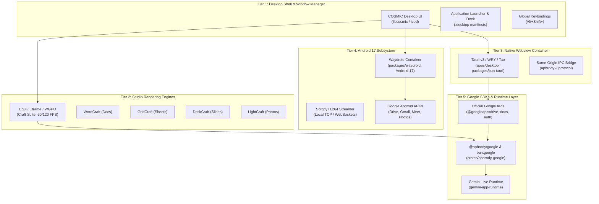

# Bun OS Native Integration: COSMIC, Iced, Egui, Tauri, Waydroid & Google SDKs

**Target Platform:** Bun OS (Unified Image: Android 17, ChromiumOS components, COSMIC UI, Bun OS Rust Base)  
**Applicability:** All Google Web Apps & Android Apps running natively with full WebOS, Craft, and Aphrody Bun OS compatibility.  
**License:** Apache-2.0  
**Status:** Qualified Production Architecture  

---

## 1. Unified 5-Tier Integration Architecture



---

## 2. Tier 1: COSMIC Desktop UI & Iced Integration (`libcosmic`)

In Bun OS, the primary desktop environment is built with **COSMIC** (`libcosmic` / `iced`). Google web and Android applications integrate into the desktop shell via:

### A. FreeDesktop `.desktop` Manifests
Every application receives a hardened `.desktop` launcher in `/usr/share/applications/` and `~/.local/share/applications/`:

```ini
[Desktop Entry]
Version=1.0
Type=Application
Name=Google Drive (Aphrody)
GenericName=Cloud Storage & File Workspace
Comment=Open Google Drive with local-first sync in Bun OS
Exec=aphrody app open google-drive
Icon=com.google.android.apps.docs
Terminal=false
Categories=Office;FileTransfer;Network;
MimeType=application/vnd.google-apps.folder;application/vnd.google-apps.file;
StartupWMClass=aphrody-drive
Keywords=google;drive;cloud;storage;aphrody;
```

### B. Global Keybindings & Window Management
The COSMIC compositor (`cosmic-comp`) maps shortcuts to instant window launch:
- `Super + D` / `Alt + Shift + D`: Aphrody Drive / Google Drive
- `Super + O` / `Alt + Shift + O`: WordCraft / Google Docs
- `Super + S` / `Alt + Shift + S`: GridCraft / Google Sheets
- `Super + P` / `Alt + Shift + P`: LightCraft / Google Photos
- `Super + G` / `Alt + Shift + G`: Gemini Web & Voice Capsule

---

## 3. Tier 2: Egui / Eframe Native Craft Studio Acceleration

When users require local-first, zero-latency document authoring, Bun OS routes Google file formats directly to **Craft studios** built on Rust `egui` and `wgpu`:

| Google Web App | Native Craft Studio | Rust Crate Backing | Rendering Pipeline |
|---|---|---|---|
| **Google Docs** | **WordCraft** (`apps/wordcraft`) | `crates/wordcraft-ui-egui`, `wordcraft-docx`, `wordcraft-engine` | `eframe` WebGPU/WebGL2 paginated canvas |
| **Google Sheets** | **GridCraft** (`apps/gridcraft`) | `crates/gridcraft-ui-egui`, `gridcraft-xlsx`, `gridcraft-engine` | Reactive DAG cell matrix with virtualized viewport |
| **Google Slides** | **DeckCraft** (`apps/deckcraft`) | `crates/deckcraft-ui-egui`, `deckcraft-engine` | 16:9 vector slide filmstrip |
| **Google Photos** | **LightCraft** (`apps/lightcraft`) | `crates/lightcraft-ui-egui`, `lightcraft-raw`, `lightcraft-develop` | GPU-accelerated RAW demosaicing & color grading |
| **Google Drawings/PDF**| **PDFCraft** & **VectorCraft** | `crates/pdfcraft-ui-egui`, `crates/vectorcraft-ui-egui` | Bezier vector geometry & HarfBuzz font rasterizer |

---

## 4. Tier 3: Tauri v3 / WRY Native Webview Container

For Google Web Apps running in their full web richness (Gmail, Google Maps, YouTube Music, Google Calendar, Google Colab):
- Built with **Tauri v3** (`apps/desktop/src-tauri` and `packages/bun-tauri`), leveraging `tauri_runtime_wry::Wry`.
- **Custom URI Protocol:** `aphrody://` for asset loading and loopback IPC without CORS friction.
- **Persistent Partitioning:** Cookies, OAuth sessions, and IndexedDB state are stored cleanly in `$XDG_DATA_HOME/aphrody/webapps/<app-id>/` without leaking to untrusted sites.
- **Hardware Acceleration:** WebGL and WebGPU are enabled with zero compositor copy overhead.

---

## 5. Tier 4: Android 17 Subsystem & Container (Waydroid)

For applications where the Android APK provides features unavailable on the web (offline background sync, Google Play Services notifications, biometric passkeys):
- **Runtime:** Android 17 container orchestrated by `packages/waydroid` and `apps/bun-android`.
- **Display Streaming:** `packages/waydroid/src/scrcpy.ts` and `session.ts` decode the H.264 video buffer from `scrcpy-server` over local TCP (`127.0.0.1:24713`), rendering directly to a Wayland sub-surface or WebOS `<canvas>`.
- **Input Pipeline:** Touch, mouse gestures, scroll wheels, and keyboard events are translated through `inputToControl()` in `packages/waydroid/src/gateway.ts`.
- **Intent Dispatcher:** Bun OS shells can launch any Google Android app via ADB intent:
  ```bash
  adb shell am start -n com.google.android.apps.docs/com.google.android.apps.docs.app.NewMainProxyActivity
  ```

---

## 6. Tier 5: Official & Community Google SDKs Integration

All official Google APIs and developer SDKs are wired into the Bun OS backend via `@aphrody/google` (`packages/google`):

```ts
import google from "bun:google"; // or import { createGoogleServices } from "@aphrody/google";

// 1. Authenticate via Bun OS token broker (crates/bun-os-google)
const tokenProvider = google.backendToken({
  base: "http://127.0.0.1:8790",
  adminToken: process.env.APHRODY_ADMIN_TOKEN!,
});

// 2. Instantiate Drive and Docs services
const services = google.createGoogleServices({ token: tokenProvider });

// 3. Export Docs to WordCraft DOCX or native Markdown
const docSnapshot = await services.docs.saveGoogleDocSnapshot("1BxiMVs0XRA5nFMdKvBdBZjgmUUqptlbs74OgvE2upms", "/tmp/doc.json");
const markdown = google.googleDocSnapshotToWordCraftMarkdown(docSnapshot);

// 4. Bi-directional sync with Aphrody Drive
await services.drive.syncLocalTree("/home/user/Drive", { direction: "bidirectional" });
```

---

## 7. Complete WebOS Registry (`apps/webos/apps.json`)

All Google web applications are fully registered in `apps/webos/apps.json`:
- `google-drive` (`KeyD`)
- `google-docs` (`KeyO`)
- `google-sheets` (`KeyS`)
- `google-slides`
- `gmail` (`KeyM`)
- `google-calendar` (`KeyC`)
- `google-meet`
- `google-keep` (`KeyK`)
- `google-one`
- `google-gemini` (`KeyG`)
- `google-colab`
- `youtube` (`KeyY`)
- `youtube-music`
- `photos` (`KeyP`)
- `maps`
- `google-earth`
- `google-finance`
- `google-flights`
- `google-fonts`

Each app opens in a native window with titlebar integration, snap-to-edge docking, and state persistence.
