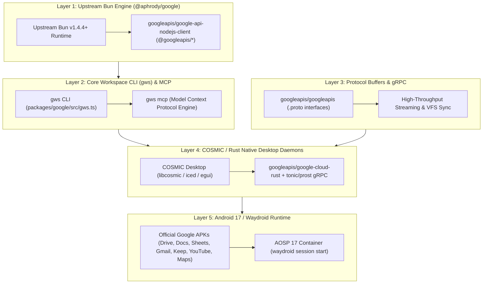

# Google APIs & SDKs Ecosystem — Bun OS Native Integration Map

> **Reference Source**: [`https://github.com/orgs/googleapis/repositories?q=sort:stars`](https://github.com/orgs/googleapis/repositories?q=sort:stars)  
> **Workspace**: `bun-os` (`packages/google`, `crates/bun-os-google`, `apps/webos`)  
> **Architecture**: Clean-room implementation, zero closed tracking, native Upstream Bun v1.4.4+ and Rust runtime.

---

## 1. Top-Starred `googleapis` Repositories Analysis

| Rank | Repository | Stars | Language | Bun OS Integration Role |
| :--- | :--- | :--- | :--- | :--- |
| **1** | **[`googleapis/mcp-toolbox`](https://github.com/googleapis/mcp-toolbox)** | ~16.8k | Go / Python | **Model Context Protocol (MCP)**: Inspires and bridges Bun OS's native Google MCP servers (`gws mcp`, `bun:google` MCP tools) for Antigravity & LLM agents. |
| **2** | **[`googleapis/google-api-nodejs-client`](https://github.com/googleapis/google-api-nodejs-client)** (`googleapis`) | ~12.3k | TypeScript / Node | **Bun Engine Client**: Direct zero-overhead execution on Upstream Bun v1.4.4+. Provides base typings, OAuth2 client, and discovery client across all 200+ Google APIs. |
| **3** | **[`googleapis/google-api-php-client`](https://github.com/googleapis/google-api-php-client)** | ~9.8k | PHP | Web backend reference implementations for enterprise deployments. |
| **4** | **[`googleapis/google-api-python-client`](https://github.com/googleapis/google-api-python-client)** | ~9.0k | Python | AI/ML pipelines, Colab interop, and data engineering scripts in Bun OS. |
| **5** | **[`googleapis/googleapis`](https://github.com/googleapis/googleapis)** | ~8.8k | Protobuf / Starlark | **Canonical Public Interface Definitions**: Protocol Buffer (`.proto`) and gRPC service descriptors for all Google Cloud and Workspace services. Used with `prost` / `tonic` in Bun OS Rust crates. |
| **6** | **[`googleapis/google-cloud-go`](https://github.com/googleapis/google-cloud-go)** | ~4.5k | Go | High-performance Go microservices reference and cloud storage transport models. |
| **7** | **[`googleapis/google-cloud-java`](https://github.com/googleapis/google-cloud-java)** | ~2.1k | Java | Android (AOSP 17 / Waydroid) client library foundation. |
| **8** | **[`googleapis/google-cloud-cpp`](https://github.com/googleapis/google-cloud-cpp)** | ~1.2k | C++ | Low-level C++ bindings for performance-critical graphics and ML runtimes. |
| **9** | **[`googleapis/google-cloud-dotnet`](https://github.com/googleapis/google-cloud-dotnet)** | ~1.1k | C# | Enterprise .NET tooling and Windows platform interop. |
| **10** | **[`googleapis/google-cloud-rust`](https://github.com/googleapis/google-cloud-rust)** | ~960+ | Rust | **Native Rust System Daemons**: Idiomatic Rust clients for GCP Storage, PubSub, KMS, and Spanner used in Bun OS native backend services (`crates/bun-os-*`). |

---

## 2. Bun OS Architecture: 5-Layer Integration Pipeline

---

## 3. Comprehensive Service-to-SDK & Tooling Matrix

| Google Service | Canonical Protobuf (`googleapis/googleapis`) | Official Node/TS SDK (`googleapis`) | Native Rust Crate / CLI (`gws`) | Bun OS Native Target |
| :--- | :--- | :--- | :--- | :--- |
| **Google Drive** | `google/apps/drive/v3` | `@googleapis/drive` | `gws drive files list` / `crates/bun-os-google` | COSMIC Files VFS / OPFS Sync (`/drive`) |
| **Google Docs** | `google/apps/docs/v1` | `@googleapis/docs` | `gws docs documents get` | Native Editor Canvas (`/docs`, `prosemirror-collab`) |
| **Google Sheets** | `google/apps/sheets/v4` | `@googleapis/sheets` | `gws sheets spreadsheets get` | Local Canvas Grid Engine (`/sheets`, DuckDB-Wasm) |
| **Google Slides** | `google/apps/slides/v1` | `@googleapis/slides` | `gws slides presentations get` | SVG/Canvas Slide Engine (`/slides`, `fabric.js`) |
| **Gmail** | `google/apps/gmail/v1` | `@googleapis/gmail` | `gws gmail messages list` | COSMIC Mail client / SQLite WAL inbox |
| **Google Calendar** | `google/apps/calendar/v3`| `@googleapis/calendar` | `gws calendar events list` | COSMIC Applet Time & Calendar widget |
| **Google Meet** | `google/apps/meet/v2` | `@googleapis/meet` | `gws meet spaces create` | WebRTC / AV1 Native Video Room |
| **Google Keep** | `google/apps/keep/v1` | `@googleapis/keep` | `gws keep notes list` | Quick Notes Panel (`/keep`, SQLite offline) |
| **YouTube** | `google/youtube/v3` | `@googleapis/youtube` | `gws youtube videos list` | Native Player (`/youtube`, MPV/wgpu backend) |
| **Google Maps** | `google/maps/*` | `@googlemaps/google-maps-services-js` | `gws maps geocode` | Vector Map Tile Engine (`/maps`, MapLibre GL) |
| **Google Photos** | `google/photos/library/v1`| `@googleapis/photoslibrary` | `gws photos mediaItems list` | COSMIC Media Gallery / Background Auto-Sync |
| **Gemini AI** | `google/ai/generativelanguage/v1beta` | `@google/genai` | `bun:google` / `gemini-app-runtime` | Core OS Intelligence, Live Voice, STC |
| **Cloud Storage** | `google/storage/v2` | `@google-cloud/storage` | `google-cloud-rust::storage` | High-throughput object store / S3 gateway |
| **Cloud Firestore**| `google/firestore/v1` | `@google-cloud/firestore` | `google-cloud-rust::firestore` | Real-time structured document store |
| **Cloud BigQuery** | `google/cloud/bigquery/v2`| `@google-cloud/bigquery` | `google-cloud-rust::bigquery` | Analytics & data processing engine |
| **Cloud PubSub** | `google/pubsub/v1` | `@google-cloud/pubsub` | `google-cloud-rust::pubsub` | Fleet-wide event bus & telemetry streaming |

---

## 4. Key Architectural Patterns in Bun OS

### 1. Dynamic API Discovery (`gws`)
Instead of hardcoding hundreds of thousands of lines of client wrappers, Bun OS leverages the **Google Discovery Service v1** (`https://www.googleapis.com/discovery/v1/apis/<service>/<version>/rest`):
- Dynamically resolves endpoints, HTTP methods, required parameters, and JSON schemas at runtime.
- Caches discovery documents in `DISCOVERY_CACHE` and local Bun OS SQLite storage.
- Automatically generates command CLI interfaces (`gws <service> <resource> <method>`).

### 2. Model Context Protocol (MCP) Server for Agents
Bun OS integrates an official MCP server directly within `gws` (`bun gws mcp` or `packages/google/src/gws.ts:startGwsMcpServer`):
- Exposes tools: `google_discover_api`, `google_execute_api`, `google_search_files`, `google_read_document`, `google_list_messages`.
- Allows Antigravity, Claude, and Gemini agents to orchestrate any Google Workspace API natively without custom wrappers.

### 3. Native Upstream Bun v1.4.4+ Acceleration
- Direct ESM imports (`import { google } from "googleapis"`).
- Native TLS, HTTP/2, and HTTP/3 pipelining built into Bun's Zig/C++ network stack.
- Zero-copy buffer transfers with `Bun.file(path)` and `Bun.write(dest, stream)`.
- Fast TypeScript typechecking via `bun check` (TypeScript 7 / tsgo).
