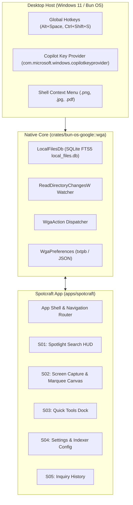

# Spotcraft — System Architecture & Component Design

> **Workspace**: `bun-os`  
> **App Directory**: `apps/spotcraft`  
> **Backend Service**: `crates/bun-os-google` (`bun_google::wga`)  
> **Runtime**: Upstream Bun v1.4.4+ & Rust Native Host

---

## 1. Architectural Layers

---

## 2. Component Specifications

### S01: Spotlight Search HUD
- **Container**: Floating card, 640px width, centered horizontally, 120px from top of screen.
- **Backdrop**: Acrylic blur (`backdrop-filter: blur(24px)`), Midnight Obsidian `#0F172A` with 90% opacity, border `1px solid #334155`.
- **Input**: 20px typography, autofocus, clear button (`Esc`), keyboard navigation for results list.
- **Results List**: Virtualized scrollable list with item icons (file, app, web, calculation), category badge, path metadata, and quick action shortcuts (`Enter`, `Ctrl+Enter`, `Alt+C`).

### S02: Screen Capture & Marquee Canvas
- **Container**: `100vw × 100vh`, fixed position, transparent background, crosshair cursor.
- **Selection**: Dynamic HTML5 Canvas or SVG drag rectangle with Electric Violet border (`#7C3AED`) and translucent Cyber Cyan fill (`rgba(6, 182, 212, 0.15)`).
- **Floating Action Pill**: Appears dynamically adjacent to user selection with actions:
  - "Inspect with AI" (`Enter`)
  - "Copy Pixels" (`Ctrl+C`)
  - "Search Visuals" (`Ctrl+V`)
  - "Cancel" (`Esc`)

### S03: Quick Tools Dock
- Minimalist pill dock positioned at bottom-right or pinned to system tray.
- Single-click triggers for Capture, Spotlight, Voice Assistant, Index Status.

### S04: Settings & Indexer Management
- Directory list with toggle switches (`Documents`, `Downloads`, `Projects`, `Pictures`).
- Index statistics: Total indexed count, last scan timestamp, database size, rebuild button.
- Theme and hotkey preferences.
