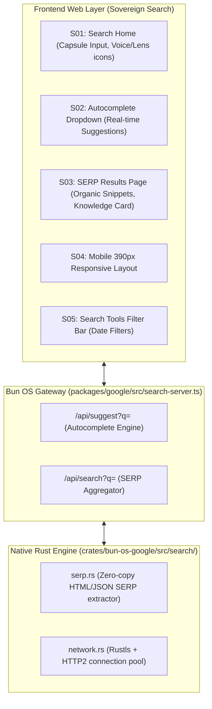

# Google Search Clean-Room Architecture

> **Workspace**: `bun-os`  
> **Source Target**: `https://www.google.com/?hl=fr` & `https://www.google.com/search`  
> **Clean-Room Implementation**: Sovereign Search Engine (`@aphrody/google` + `crates/bun-os-google::search`)

---

## 1. System Architecture



---

## 2. Screen & Component Matrix

| Screen | Components | States |
| :--- | :--- | :--- |
| **S01 Search Home** | Logo branding, search box capsule, mic icon, camera icon, action buttons, footer bar | Default, Input Focused, Dark/Light mode |
| **S02 Autocomplete** | Suggestion list container, trending query icons, search icons, delete entry buttons | Empty, Typing, Highlighting item |
| **S03 SERP Results** | Sticky top search bar, category filter tabs (`Tous`, `Images`, `Vidéos`, etc.), organic result cards, knowledge sidecard, pagination bar | Skeletons loading, Results filled, Zero results |
| **S04 Mobile View** | Sticky search pill, horizontally scrolling category chips, continuous scroll cards | 390px touch viewport |
| **S05 Search Tools** | Dropdown triggers for Time (`Moins de 24h`, `Moins d'un an`), Exact matches | Closed, Open dropdown |

---

## 3. Data & API Schemas

### `/api/suggest` Response
```json
[
  "bun os",
  [
    "bun os download",
    "bun os arch linux",
    "bun os rust",
    "bun os documentation"
  ]
]
```

### `/api/search` Response
```json
{
  "query": "bun os",
  "totalResults": 384000,
  "searchTimeSec": 0.12,
  "organic": [
    {
      "title": "Bun OS — Unified Sovereign Operating System",
      "url": "https://aphrody.com/bun-os",
      "displayUrl": "aphrody.com > bun-os",
      "snippet": "Arch-based Linux distribution and product workspace built on the Upstream Bun runtime and COSMIC desktop.",
      "favicon": "https://aphrody.com/favicon.ico"
    }
  ],
  "knowledgeCard": {
    "title": "Bun OS",
    "type": "Operating System",
    "description": "A modern unified operating system combining Android, ChromiumOS components, and COSMIC with Upstream Bun.",
    "attributes": {
      "Initial release": "2026",
      "Developer": "Aphrody Labs",
      "License": "Apache-2.0 / MIT"
    }
  }
}
```
