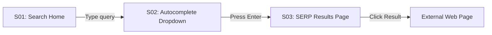

# Google Search (`https://www.google.com/?hl=fr`) — Reconnaissance Map

> **Target URL**: `https://www.google.com/?hl=fr` & `https://www.google.com/search`  
> **Platform**: Web (Desktop 1440px & Mobile 390px)  
> **Recon Scope**: Clean-room UX analysis of Google Search Home, Autocomplete Suggestions Dropdown, Search Engine Results Page (SERP), Knowledge Graph & Organic Cards, Filter Tabs, and Mobile Layout.

---

## 1. Scope

1. **Target**: Google Search Web (`google.com/?hl=fr`).
2. **Slice**:
   - **Search Home (S01)**: Centered Google branding, multi-modal search input (text query, voice dictation icon, Google Lens visual search icon), "Recherche Google" and "J'ai de la chance" action buttons, language toggle (`fr` / `en`).
   - **Autocomplete Dropdown (S02)**: Predictive search suggestions with query completion, trending queries, query removal, and instant keyboard navigation (`Up`/`Down`/`Enter`).
   - **SERP (Search Engine Result Page - S03)**: Top navigation bar, filter chips (Tous, Images, Vidéos, Actualités, Shopping, Outils), organic search snippet cards (favicon, title, URL breadcrumb, snippet snippet), rich sitelinks, knowledge graph sidecard, and pagination footer.
   - **Mobile Layout (S04)**: Sticky header search box, horizontal carousel filter chips, unified continuous scroll cards.
3. **Target Audience**: Bun OS sovereign search front-end (`aphrody-search` / `Spotcraft` / `Bun Search`), allowing private, ad-free web queries.

---

## 2. Reference Sources

| Source | URL | Insights Recovered |
| :--- | :--- | :--- |
| **Search Home (FR)** | `https://www.google.com/?hl=fr` | Minimalist layout, search box shadow elevation, French localized strings. |
| **Live Chrome CDP Session** | `http://127.0.0.1:15298` (Headless CDP) | Real-time DOM inspection, CSS variables, autocomplete input dispatch. |
| **Google Search Help Center**| `https://support.google.com/websearch` | Filter operator specs (`site:`, `filetype:`, `""`), SafeSearch rules. |
| **Google Custom Search JSON API** | `https://developers.google.com/custom-search/v1/reference/rest/v1/cse/list` | Authoritative data schema for organic results, metadata, and sitelinks. |
| **Google Suggest API** | `https://suggestqueries.google.com/complete/search?client=chrome&q=` | Public JSON endpoint schema for autocomplete suggestion lists. |

---

## 3. Screen Inventory

| ID | Screen Name | Route / Trigger | Purpose | Key Components | States Recorded |
| :--- | :--- | :--- | :--- | :--- | :--- |
| **S01** | **Search Home** | `/?hl=fr` | Minimalist entrypoint for user queries | Logo, capsule input box, voice icon, Lens icon, submit buttons, footer links | Clean, Focused, Dark/Light |
| **S02** | **Suggestions Dropdown** | Input `onInput` | Real-time predictive query autocomplete | Rounded container, query text, bold suffix, search icon, trending icon | Loading, Populated, Empty |
| **S03** | **Search Engine Results (SERP)** | `/search?q=...` | Primary discovery & information display | Sticky header, search bar, filter tabs, organic snippets, knowledge card | Normal, Paginated, Zero-results |
| **S04** | **Mobile SERP View** | `/search?q=...` (390px) | Touch-optimized search experience | Compact search pill, horizontal scrollable category bar, card snippets | Mobile viewport, Infinite scroll |
| **S05** | **Search Tools Bar** | "Outils" button click | Precise filtering of time and language | Dropdowns for Date (Toutes les dates, Moins d'une heure, Moins de 24h, Moins d'une semaine), Exact match | Hidden, Expanded |

---

## 4. User Flows

### Flow F01: Standard Web Query from Home

- **Happy Path**: 2 user actions (type query, press Enter). Results appear in <300ms.
- **Edge cases**: Zero results ("Aucun résultat trouvé"), spelling correction ("Essayez avec l'orthographe..."), offline connection error.

### Flow F02: Autocomplete Navigation
- **Step 1**: User types `bun os`.
- **Step 2**: Dropdown opens with 8 to 10 suggestions.
- **Step 3**: User presses `Down Arrow` to highlight suggestion #2 (`bun os download`).
- **Step 4**: Search input text updates to highlighted item; pressing `Enter` submits query.

### Flow F03: Time-Constrained Search
- **Step 1**: From S03 SERP, user clicks "Outils".
- **Step 2**: S05 Tools sub-bar expands with "Date indifférente" dropdown.
- **Step 3**: User selects "Moins d'un an" -> query param `&tbs=qdr:y` is added -> SERP re-renders filtered items.

---

## 5. UI Component Hierarchy

| Component | Variants | States | Used On |
| :--- | :--- | :--- | :--- |
| **SearchBar** | Home Large (44px/48px), SERP Compact (40px) | Default, Focus, Typing, With Clear button | S01, S02, S03, S04 |
| **ActionButton** | Primary Grey, Blue Call-to-action | Default, Hover, Active, Disabled | S01, S05 |
| **SuggestionItem** | Standard query, Trending query, URL direct | Default, Selected (Keyboard arrow) | S02 |
| **FilterTab** | Active (colored underline), Inactive | Default, Hover, Selected | S03, S04 |
| **OrganicSnippet** | Standard text, With sitelinks, Rich media card | Default, Visited link (`:visited`) | S03, S04 |
| **KnowledgeCard** | Entity sidebar, Quick answer calculator | Expanded, Collapsed | S03 |
| **Pagination** | Numbered page buttons, Mobile "Plus de résultats" | Active page, Next page | S03, S04 |

---

## 6. Inferred Data Model

```
┌─────────────────────────────────────────────────────────────┐
│                       SearchQuery                           │
├───────────────────┬──────────────┬──────────────────────────┤
│ query_id          │ UUID         │ Unique identifier        │
│ raw_text          │ String       │ "bun os"                 │
│ language          │ String       │ "fr"                     │
│ country           │ String       │ "FR"                     │
│ time_filter       │ Enum         │ any | past_hour | past_day │
│ safe_search       │ Boolean      │ true | false             │
└───────────────────┴──────────────┴──────────────────────────┘
                              │
                              ▼ 1:N
┌─────────────────────────────────────────────────────────────┐
│                      SearchResultItem                       │
├───────────────────┬──────────────┬──────────────────────────┤
│ item_id           │ UUID         │ Result identifier        │
│ title             │ String       │ Page title               │
│ url               │ String       │ Target URL               │
│ display_url       │ String       │ Clean breadcrumb         │
│ snippet           │ String       │ Highlighted match text   │
│ published_date    │ Optional<Date> Time metadata             │
│ favicon_url       │ String       │ Host domain favicon      │
│ rank              │ Integer      │ Positional ranking       │
└───────────────────┴──────────────┴──────────────────────────┘
```

---

## 7. What Cannot Be Cloned (Clean-Room Scope Exclusions)

1. **Google's Proprietary Web Index**: A crawl graph of billions of web pages and PageRank weights. Clean-room alternative: Proxy through sovereign metasearch APIs (SearXNG / DuckDuckGo / Brave Search / Bun OS public search engine).
2. **Google Ads & Sponsored Auction**: Sponsored ad links (`googleadservices.com`). Excluded by design — Spotcraft search is zero-ad, sovereign, and privacy-first.
3. **Closed User Profiling & Tracking**: Persistent tracking cookies (`NID`, `CONSENT`, `AEC`). Clean-room clone operates completely stateless or with encrypted local-only history.

---

## 8. Sizing & Implementation Plan

- **Screens**: 5 screens (S01 to S05)
- **Flows**: 4 primary flows
- **Difficulty Rating**: **M (Medium)**
- **Hardest Parts**:
  1. Instant autocomplete suggestion debounce and keyboard selection.
  2. Responsive SERP layout matching desktop sidebar + mobile card layout.
  3. Clean-room SERP parsing & metasearch proxying without triggering anti-bot CAPTCHAs.
