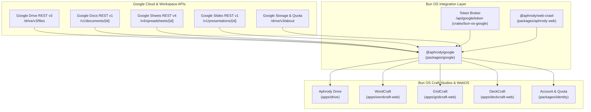

# Google Workspace & Google Apps End-to-End Endpoint, API, and UI Mapping

**Scope:** Complete reproducible mapping of Google Workspace (Drive, Docs, Sheets, Slides, One Quotas) to Bun OS Craft applications (`apps/drive`, `apps/wordcraft`, `apps/gridcraft`, `apps/deckcraft`), driven by `@aphrody/google` (`packages/google`) and `@aphrody/web-crawl` (`packages/aphrody-web`).  
**License:** Apache-2.0  
**Status:** Qualified Clean-Room Specification  

---

## 1. Architecture Flow & Package Mapping



---

## 2. Exhaustive Endpoint & API Matrix

### A. Google Drive REST API v3 $\rightarrow$ Aphrody Drive (`apps/drive`)

| Method | Upstream Google Endpoint | Request / Payload | Response Shape | Aphrody Handler / Implementation |
|---|---|---|---|---|
| `GET` | `/drive/v3/files` | `q`, `fields`, `pageSize`, `pageToken`, `orderBy` | `{ files: DriveFile[], nextPageToken?: string }` | `packages/google/src/services.ts` $\rightarrow$ `listFiles()` |
| `GET` | `/drive/v3/files/{fileId}` | `fileId`, `fields` (`id,name,mimeType,size,md5Checksum,modifiedTime`) | `DriveFile` metadata object | `packages/google/src/services.ts` $\rightarrow$ `getFile()` |
| `POST` | `/upload/drive/v3/files?uploadType=resumable` | Initial metadata (`name`, `mimeType`, `parents`), binary stream chunks | `201 Created` with final `DriveFile` metadata | `packages/google/src/drive-sync.ts` $\rightarrow$ `uploadFile()` |
| `GET` | `/drive/v3/files/{fileId}/export` | `fileId`, `mimeType` (`application/pdf`, `docx`, `pptx`, `xlsx`) | Binary file stream | `packages/google/src/services.ts` $\rightarrow$ `exportFile()` |
| `DELETE` | `/drive/v3/files/{fileId}` | `fileId` (moves to trash or permanent purge) | `204 No Content` | `packages/google/src/services.ts` $\rightarrow$ `deleteFile()` |
| `GET` | `/drive/v3/about` | `fields=storageQuota,user` | `{ storageQuota: { limit, usage, usageInDrive, usageInDriveTrash }, user }` | `packages/google/src/services.ts` $\rightarrow$ `getQuota()` |
| `POST` | `/drive/v3/files/{fileId}/permissions` | `role` (`reader,commenter,writer`), `type` (`user,anyone`) | `{ id: string, role: string, type: string }` | `apps/drive/src/acl.ts` $\rightarrow$ `setPermission()` |

---

### B. Google Docs REST API v1 $\rightarrow$ WordCraft (`apps/wordcraft-web`)

| Method | Upstream Google Endpoint | Request / Payload | Response Shape | Aphrody Handler / Implementation |
|---|---|---|---|---|
| `GET` | `/v1/documents/{documentId}` | `documentId`, `includeTabsContent: true` | Complete `GoogleDocument` JSON (Title, Body StructuralElements, Paragraphs, Tables, InlineObjects) | `packages/google/src/docs-wordcraft.ts` $\rightarrow$ `saveGoogleDocSnapshot()` |
| `POST` | `/v1/documents` | `{ title: string }` | `{ documentId: string, title: string }` | WordCraft Studio $\rightarrow$ New Document |
| `POST` | `/v1/documents/{documentId}:batchUpdate` | `{ requests: Array<InsertText \| UpdateTextStyle \| InsertTable> }` | `{ replies: Array<...> }` | `packages/google/src/docs-wordcraft.ts` $\rightarrow$ Projection engine |
| `EXPORT` | `/drive/v3/files/{fileId}/export?mimeType=application/vnd.openxmlformats-officedocument.wordprocessingml.document` | `fileId` | Streaming DOCX binary | `packages/google/src/docs-wordcraft.ts` $\rightarrow$ `exportGoogleDocForWordCraft()` |
| `NATIVE` | Offline Snapshot Projection | Raw `GoogleDocument` AST JSON | Clean GitHub Flavored Markdown / Aphrody Document Model | `packages/google/src/drive-markdown.ts` $\rightarrow$ `nativeMarkdown()` |

---

### C. Google Sheets REST API v4 $\rightarrow$ GridCraft (`apps/gridcraft-web`)

| Method | Upstream Google Endpoint | Request / Payload | Response Shape | Aphrody Handler / Implementation |
|---|---|---|---|---|
| `GET` | `/v4/spreadsheets/{spreadsheetId}` | `includeGridData: false` | `{ sheets: Array<{ properties: { sheetId, title, gridProperties: { rowCount, columnCount } } }> }` | GridCraft Studio $\rightarrow$ Sheet Tabs & Structure |
| `GET` | `/v4/spreadsheets/{spreadsheetId}/values/{range}` | `range` (`A1:Z100`), `valueRenderOption` (`FORMATTED_VALUE \| UNFORMATTED_VALUE \| FORMULA`) | `{ values: Array<Array<string \| number>> }` | GridCraft DAG engine $\rightarrow$ Cell Value Loader |
| `POST` | `/v4/spreadsheets/{spreadsheetId}/values/{range}?valueInputOption=USER_ENTERED` | `{ values: Array<Array<unknown>> }` | `{ updatedCells, updatedRows, updatedColumns }` | GridCraft Local-First Sync $\rightarrow$ Range Mutator |
| `EXPORT` | `/drive/v3/files/{fileId}/export?mimeType=application/vnd.openxmlformats-officedocument.spreadsheetml.sheet` | `fileId` | Streaming XLSX binary | `GridCraft` $\rightarrow$ `rust_xlsxwriter` & `calamine` parser |

---

### D. Google Slides REST API v1 $\rightarrow$ DeckCraft (`apps/deckcraft-web`)

| Method | Upstream Google Endpoint | Request / Payload | Response Shape | Aphrody Handler / Implementation |
|---|---|---|---|---|
| `GET` | `/v1/presentations/{presentationId}` | `presentationId` | `{ presentationId, title, slides: Array<{ pageElements, slideProperties }> }` | DeckCraft Studio $\rightarrow$ Filmstrip Loader |
| `EXPORT` | `/drive/v3/files/{fileId}/export?mimeType=application/vnd.openxmlformats-officedocument.presentationml.presentation` | `fileId` | Streaming PPTX binary | `packages/google/src/slides-deckcraft.ts` $\rightarrow$ `openGoogleSlidesInDeckCraft()` |
| `DISPATCH` | `file.openBytes` (Same-Origin iframe protocol) | `{ name: string, data: base64 }` | In-process WASM command dispatch | `packages/google/src/slides-deckcraft.ts` $\rightarrow$ `DeckCraftDispatch` |

---

### E. Google One & Storage Quota $\rightarrow$ Aphrody Account (`packages/identity`)

| Method | Upstream Google Endpoint | Request / Payload | Response Shape | Aphrody Handler / Implementation |
|---|---|---|---|---|
| `GET` | `/drive/v3/about?fields=storageQuota` | None | `{ storageQuota: { limit: string, usage: string, usageInDrive: string, usageInDriveTrash: string } }` | `packages/identity/src/quota.ts` $\rightarrow$ Storage Gauge |
| `AUDIT` | Cleanup / Trash Query | `q=trashed = true or size > 10485760` | Large files and orphaned items list | Aphrody Storage Manager $\rightarrow$ Cleanup Assistant |

---

## 3. UI Component Hierarchy & Reproducible Bindings

| Screen ID | Target View | Reference Capture (Live Chrome) | Core UI Widgets & Tokens | Aphrody Rust / WASM Binding |
|---|---|---|---|---|
| **S01** | Suite Hub | [`s01-workspace-suite-landing.png`](file:///C:/src/bun-os/replica/screens/google-workspace/s01-workspace-suite-landing.png) | Topbar nav, Hero bento grid, Category tabs | `packages/aphrody-web` / `apps/shell-web` |
| **S02** | Drive Product | [`s02-drive-product-overview.png`](file:///C:/src/bun-os/replica/screens/google-workspace/s02-drive-product-overview.png) | Feature ribbons, Storage tiers, CTA button | `apps/craft-web` landing |
| **S03** | Drive Home | [`s03-drive-home-dashboard.png`](file:///C:/src/bun-os/replica/screens/google-workspace/s03-drive-home-dashboard.png) | Search bar with type chips, Suggested cards | `apps/drive/src/views/home.rs` |
| **S04** | My Drive Explorer | [`s04-drive-my-drive-explorer.png`](file:///C:/src/bun-os/replica/screens/google-workspace/s04-drive-my-drive-explorer.png) | Breadcrumbs, File table / Grid, Sort headers | `apps/drive/src/views/explorer.rs` |
| **S05** | Docs Hub | [`s05-docs-home-hub.png`](file:///C:/src/bun-os/replica/screens/google-workspace/s05-docs-home-hub.png) | Template gallery ribbon, Recent docs table | `apps/wordcraft-web/src/hub.rs` |
| **S06** | Docs Canvas | [`s06-docs-editor-canvas.png`](file:///C:/src/bun-os/replica/screens/google-workspace/s06-docs-editor-canvas.png) | Paginated canvas, Ruler, Formatting toolbar | `apps/wordcraft-web/src/editor.rs` |
| **S07** | Sheets Hub | [`s07-sheets-home-hub.png`](file:///C:/src/bun-os/replica/screens/google-workspace/s07-sheets-home-hub.png) | Spreadsheet templates carousel, Recents | `apps/gridcraft-web/src/hub.rs` |
| **S08** | Sheets Grid | [`s08-sheets-editor-grid.png`](file:///C:/src/bun-os/replica/screens/google-workspace/s08-sheets-editor-grid.png) | Formula bar ($f_x$), $A1$ grid, Sheet tabs | `apps/gridcraft-web/src/grid.rs` |
| **S09** | Slides Hub | [`s09-slides-home-hub.png`](file:///C:/src/bun-os/replica/screens/google-workspace/s09-slides-home-hub.png) | Presentation templates, Recents grid | `apps/deckcraft-web/src/hub.rs` |
| **S10** | Slides Editor | [`s10-slides-editor-canvas.png`](file:///C:/src/bun-os/replica/screens/google-workspace/s10-slides-editor-canvas.png) | Filmstrip rail, 16:9 canvas, Themes drawer | `apps/deckcraft-web/src/editor.rs` |

---

## 4. Reproducible Verification Script

To verify the TypeScript contracts and endpoint typings across `@aphrody/google` and `@aphrody/web-crawl`, run:

```bash
bun test packages/google/test
bun check --cwd packages/google
```

The contracts enforce zero-telemetry, strict relative-path security, local OPFS persistence, and clean error states.
